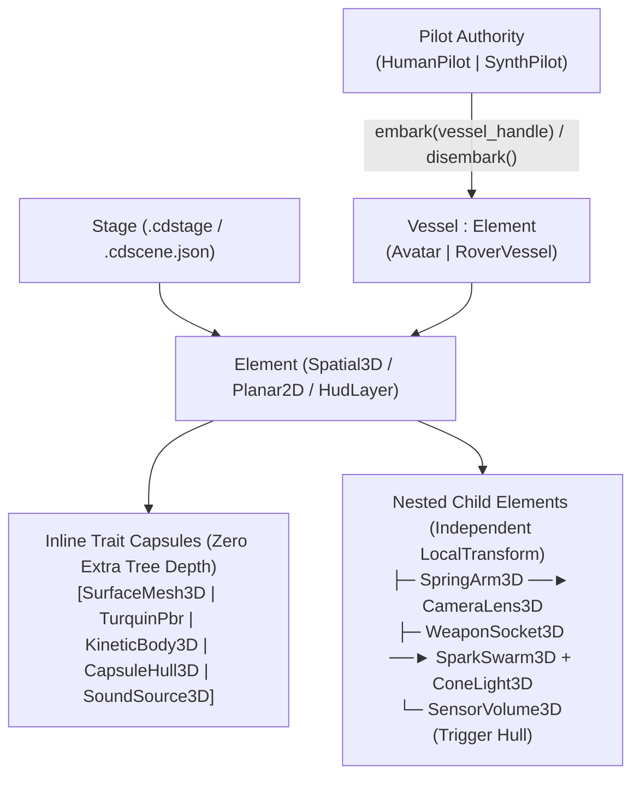

# ADR-20261018-element-vessel-nested-capsule-architecture: CHROMODYNAMIC `Element / Vessel / Pilot / Nested Trait Capsule` Architecture (`cd::scene::ElementCapsuleTree`)

- **Status**: Accepted
- **Date**: 2026-10-18
- **Layer Rank**: Level 3 (`engine/world/scene` — `cd::scene::ElementCapsuleTree`) & Level 4 (`cd::element_core`, `cd::stage`, `cd::gameplay_vessel`, `cd::gameplay_pilot`, `cd::gameplay_director`)
- **Subsystems**: `engine/world/scene`, `engine/world/ecs`, `engine/world/world_container`, `apps/editor`

---

## 1. Bağlam & Motivasyon (Context & Problem Statement)

Genel amaçlı 2B/3B oyun motorlarında sahne temsili ve oynanış kurgusu tarihsel olarak iki uç yaklaşıma bölünmüştür:

1. **Derin Polimorfik Düğüm/Aktör Ağaçları (Godot 4 `Node` Ağacı & Unreal Engine `AActor` / `APawn` Hiyerarşisi)**:
   - Godot 4, `Node` taban sınıfından türeyen **219 ayrı düğüm alt sınıfı** (`Node3D`, `CharacterBody3D`, `CollisionShape3D`, `MeshInstance3D`, `DirectionalLight3D`, `WorldEnvironment`, `AudioStreamPlayer3D`, `NavigationAgent3D`, `AnimationPlayer`, `AnimationTree`, `Node2D`, `Sprite2D`, `TileMapLayer`, `Control`, `BoxContainer` vb.) kullanır. Her küçük yetenek için sahne ağacına ayrı bir heap nesnesi ve çocuk düğüm eklenir. Örneğin tek bir oynanabilir karakter kurmak için en az 7–9 kardeş/çocuk düğümün (`CharacterBody3D` + `CollisionShape3D` + `MeshInstance3D` + `Skeleton3D` + `AnimationPlayer` + `SpringArm3D` + `Camera3D`) birbirine bağlanması gerekir. Bu yapı derin sanal çağrı (`_process` / `_physics_process` vtable) maliyetine, bellek parçalanmasına (cache miss) ve kırılgan düğüm yolu (`get_node("../SpringArm3D/Camera3D")`) bağımlılıklarına yol açar.
   - Unreal Engine ise `UObject -> AActor -> APawn -> ACharacter` kalıtım zincirini `UActorComponent` / `USceneComponent` yığınlarıyla birleştirir; ancak ağır `UObject` meta-veri yükü, GC (çöp toplayıcı) duraksamaları ve monolitik başlık bağımlılıkları nedeniyle kütüphane-yönelimli (`pay-only-for-what-you-use`) modüler mimarilere uymaz.
2. **Saf Düz (Flat) Arketip / Sparse-Set ECS (EnTT, Bevy, Flecs)**:
   - Bileşenleri ardışık SoA (Structure of Arrays) dizilerinde tutarak CPU önbellek yerelliğini maksimize eder. Ancak saf düz ECS; yerel-dünya dönüşüm zincirlerini (ör. bir aracın gövdesine bağlı dönen kule, kulenin ucundaki namlu soketi ve namluya bağlı parçacık/ses kaynağı), iç içe prefab şablonlarını (`.cdstage`) ve görsel editördeki sürükle-bırak hiyerarşi ergonomisini doğrudan ifade etmekte zorlanır.

**Mühendislik Problemi**: CHROMODYNAMIC, başka motorların `Node`, `Actor`, `Pawn`, `Character`, `GameMode` veya `WorldEnvironment` isimlendirmelerini ve mimari darboğazlarını kopyalamadan;
- Godot 4 ekosistemindeki **219 temel sahne düğümü yeteneğinin tamamını** (3B Uzamsal/Görsel/Fizik/Aydınlatma/Ses/Navigasyon, 2B Planar/Sprite/TileMap/Fizik, UI/Control Layout & Widget'lar, Animasyon/Durum/Zamanlayıcı akışı) ve
- CHROMODYNAMIC'e özgü **31 Next-Gen SOTA motor yeteneğini** (Cluster-DAG Sanal Geometri, ReSTIR DI/GI, Ray-Traced DDGI, Neural Radiance Caching, Turquin 2019 Multi-Scatter & Belcour-Barla 2017 Thin-Film Iridescence BRDF, Bruneton Atmosfer & Froxel Sis/Bulut, FFT Okyanus, GPU Clipmap Arazi, Jolt Voronoi Yıkım & XPBD Kumaş, MIT KEMAR HRTF Akustik, `Vessel`/`Pilot` Embark-Disembark ikiliği ve `%100 cd::ui::ChromaUi` GPU arayüzü)

toplam **250 yeteneklik tek bir birleşik çatıda**, hem **satır-içi sıfır-dolaylılık kapsülü (Inline Trait Capsule)** hem de **iç içe uzamsal alt-element hiyerarşisi (Nested Sub-Element Hierarchy)** olarak çalıştırabilen özgün bir C++23 sahne mimarisine ihtiyaç duymaktadır.

---

## 2. Reddedilen Alternatifler & Karşılaştırmalı SOTA Analizi (Alternatives Considered)

| Değerlendirme Kriteri | Alternatif A: Godot Tarzı Saf `Node` Ağacı (219 Polimorfik Alt Sınıf) | Alternatif B: Saf Düz (Flat) ECS (Yalnızca `EntityId` + Düz Bileşen Tabloları) | **Seçilen Mimari: CHROMODYNAMIC `Element / Vessel / Pilot / Nested Trait Capsule` (`cd::scene::ElementCapsuleTree`)** |
| :--- | :--- | :--- | :--- |
| **Bellek Yerleşimi & Önbellek (Cache Locality)** | Zayıf. Her düğüm ayrı heap tahsisi (`new Node3D`); ağaç gezintisinde yoğun pointer-chasing ve L1/L2 cache miss. | Çok Yüksek. SoA yoğun diziler; ancak hiyerarşik dönüşüm ve iç içe alt-bileşen ilişkileri harici arama tabloları gerektirir. | **Optimal Hibrit (SoA Arena + Düzleştirilmiş DFS Sırası)**. `Element` düğümleri ve `TraitCapsule` dilimleri bitişik (contiguous) havuzlarda tutulur; ağaç sırası topolojik olarak düzleştirilir. |
| **Tek Varlıkta Çoklu Yetenek Maliyeti** | Yüksek. Çarpışma şekli, mesh, ışık, ses ve hareket için 5–8 ayrı çocuk `Node` zorunludur; sahne ağacı şişer. | Düşük, fakat aynı tipten birden fazla alt-parça (ör. 2 farklı `Collider` veya 3 `SoundSource`) düz ECS'de doğrudan temsil edilemez. | **Çift Modlu (`Inline` + `Nested`) Kapsül**. Tekil yetenekler `Element` üzerinde sıfır-düğüm yüküyle **Inline Capsule** olarak yaşar; bağımsız yerel ofset/eklem gerektiren çoklu parçalar **Nested Capsule Element** olarak dallanır. |
| **Karakter / Araç / AI Kontrol Geçişi** | Kırılgan. `CharacterBody3D` ve `VehicleBody3D` arasında oyuncu/AI geçişi için script düzeyinde manuel kamera/girdi taşıması gerekir. | Standart bir kontrol soyutlaması yoktur; her oyun projesi kendi ad-hoc sistemini yazar. | **Birinci Sınıf `Vessel` & `Pilot` (`embark` / `disembark`) Kontratı**. `HumanPilot` ve `SynthPilot`, herhangi bir `Avatar` veya `RoverVessel` gövdesine çalışma zamanında tek çağrıyla (`embark`) binip inebilir. |
| **Kapsanan Yetenek Uzayı** | 219 standart 2B/3B/UI düğümü; donanım RT, ReSTIR, NRC, Turquin BRDF ve FFT su gibi SOTA grafik/fizik yetenekleri eksiktir. | Yalnızca veri konteyneri sağlar; hazır sahne ve oynanış yapıtaşları sunmaz. | **250 Birleşik Yetenek (219 Temel Sahne Rolü + 31 Next-Gen SOTA Kapsülü)** tek tip-güvenli şemada (`CapsuleKind`) birleşir. |
| **Katman (DAG) & Kütüphane Sınırı** | Monolitik `SceneTree` motorun tüm alt sistemlerini birbirine bağlar. | Çekirdek hafif kalır ancak üst katman entegrasyonu dağınıktır. | **Katı DAG Uyumu (Level 3 `cd::scene`)**. Alt katmanlar (`L0–L2`) sahne ağacını bilmez; her domain kapsülü bağımsız `cd_<lib>` hedefidir. |

- **Alternatif A (Godot `Node` Klonu) Neden Reddedildi?**: Her çarpışma kabuğu, materyal, ses kaynağı veya hareket davranışı için ayrı bir sanal `Node` alt sınıfı yaratmak C++23 veri yönelimli tasarım ilkelerine aykırıdır ve sahne hiyerarşisini binlerce yardımcı yaprak düğümle kirletir.
- **Alternatif B (Hiyerarşisiz Saf Düz ECS) Neden Reddedildi?**: Editör içinde ebeveyn-çocuk eklemlenmesi (`RoverVessel` -> `TurretElement` -> `BarrelSpotLight`), yerel uzayda taşınan tetikleyici hacimler ve iç içe prefab (`.cdstage`) kurgusu için birinci sınıf ağaç topolojisi şarttır.

---

## 3. Karar: Özgün `Element / Vessel / Pilot / Nested Trait Capsule` Mimarisi (`cd::scene::ElementCapsuleTree`)

### 3.1 Temel Ontoloji ve %100 Özgün CHROMODYNAMIC Terminolojisi

CHROMODYNAMIC sahne ve oynanış katmanı beş temel kavram üzerine inşa edilir:

1. **`Element` (`cd::scene::ElementHandle` / `ElementNode`)**:
   - Sahnedeki her varlığın kimlik (`UUID` + jenerasyonel `ElementHandle`), uzamsal çerçeve (`CoordinateSpace::kSpatial3D`, `kPlanar2D`, `kCanvasUi`, `kLogicOnly`), görünürlük/kilit bayrakları, katman (`LayerId`) ve tip-güvenli sinyal hattı (`Pulse<Args...>`) taşıyan çekirdek yapıtaşıdır.
2. **`TraitCapsule` (Hem Satır-İçi Eklenti Hem İç İçe Alt-Ağaç Düğümü)**:
   - Görsel mesh, PBR/Turquin materyal, ışık, atmosfer, fizik gövdesi, çarpışma kabuğu, HRTF ses kaynağı, AI devriye rotası veya UI widget gibi her fonksiyonel birim bir **`TraitCapsule`** olarak tanımlanır.
   - **İzomorfik Çift Bağlama Modu (`CapsuleMountMode`)**:
     - **`CapsuleMountMode::kInline` (Satır-İçi Kapsül)**: Kapsül, doğrudan sahibi olan `Element`'in yerel kapsül dizisine (`inline_capsules`) eklenir ve `Element`'in `WorldTransform` matrisini sıfır ekstra ağaç derinliğiyle paylaşır. Böylece Godot'da 6 ayrı çocuk düğüm gerektiren bir varlık, CHROMODYNAMIC'te tek bir `Element` satırında `[MSH] [MAT] [RGB] [CAP] [SND] [MOV]` rozetleriyle satır-içi kapsül olarak tutulabilir.
     - **`CapsuleMountMode::kNested` (İç İçe Hiyerarşik Alt-Element)**: Kapsül kendi `LocalTransform` ofsetine, bağımsız rotasyon eksenine (ör. `SpringArm3D` ucundaki `CameraLens3D`, araç üzerindeki tekerlek/taret düğümleri veya karakter el soketindeki silah/parçacık yayıcı) ihtiyaç duyduğunda, `ElementCapsuleTree` içinde ebeveyn `Element`'in altında gerçek bir çocuk/torun hiyerarşisi (`parent_element` / `first_child` / `next_sibling`) olarak dallanır.
3. **`Stage` (`.cdstage` / `.cdscene.json`)**:
   - Kök `Element` ağacını, ortam kapsüllerini (`CelestialDome3D`, `AetherFog3D`, `OpticsVolume3D`) ve seviye meta verilerini barındıran, başka bir `Stage` içine tek bir `PrefabInstanceCapsule` olarak iç içe gömülebilen sahne konteyneridir.
4. **`Vessel` (`Avatar`, `RoverVessel`, `AerialVessel`)**:
   - Bir sürücü/beyin (`Pilot`) tarafından içine girilip yönetilebilen (`embark` / `disembark`) fiziksel ve kinematik gövde sözleşmesidir (`VesselControlState`: yönelim, ivme, zıplama/fren, eylem tetikleyicileri).
5. **`Pilot` (`HumanPilot` & `SynthPilot`)**:
   - Kontrol otoritesini fiziksel gövdeden (`Vessel`) tamamen ayırır. `HumanPilot` oyuncu girdilerini (`ActionMap`), yaylı kamera takibini (`CameraBrain`) ve oyun-içi HUD katmanını (`HudLayer`) yönetirken; `SynthPilot` aynı `Vessel`'ı `BehaviorTree`, `StateMachine`, `WayfinderAgent3D` (A* + RVO) ve `SquadCoordinator` ile sürer.



---

### 3.2 219 Temel Sahne Düğümü + 31 Next-Gen SOTA Yeteneğinin (250 Birleşik Yetenek) 12 Domain Kütüphanesinde Birleştirilmesi

Videodaki 219 Godot düğümünün işlevsel karşılıkları ile CHROMODYNAMIC'in 31 ileri seviye (Next-Gen SOTA) yeteneği, kopya isimler kullanılmadan **12 modüler domain ailesi** altında tek bir `CapsuleKind` (`uint16_t`) taksonomisinde birleştirilmiştir:

| # | CHROMODYNAMIC Domain & Kütüphane | Özgün `Element` / `TraitCapsule` Sınıfları | Kapsanan Temel Sahne Rolleri (219 Karşılığı) | Birleştirilen Next-Gen SOTA Yetenekleri (+31 SOTA) |
| :-: | :--- | :--- | :--- | :--- |
| **1** | **Çekirdek & Sahne Konteyneri**<br/>(`cd::element_core`, `cd::stage`, `cd::scene`) | `Element`, `Spatial3D`, `Planar2D`, `Stage`, `PrefabLinkCapsule`, `Pulse<Args...>`, `ChronoTimerCapsule`, `ResourceVault` | `Node`, `Node3D`, `Node2D`, `PackedScene`, `InstancePlaceholder`, `Timer`, `WorldEnvironment`, `ResourcePreloader`, `NodePath` (9 rol) | **(1)** `CapsuleMountMode` (Inline vs Nested çift modlu ağaç), **(2)** Sıfır-tahsisli `Pulse<Args...>` sinyal veriyolu, **(3)** Deterministik Pre-PIE Snapshot/Restore (`WorldLedger`). |
| **2** | **3B Görsel & Geometri**<br/>(`cd::elements_visual`) | `SurfaceMesh3D`, `RiggedMesh3D`, `SwarmMesh3D`, `ProceduralCSG3D`, `ProjectionDecal3D`, `SparkSwarm3D`, `TrailRibbon3D`, `TextGlyph3D`, `CameraLens3D`, `SpringArm3D`, `BoneSocket3D`, `VisibilityPortal3D` | `MeshInstance3D`, `MultiMeshInstance3D`, `CSGBox3D..CSGCombiner3D` (7), `Decal`, `GPUParticles3D`, `CPUParticles3D`, `ParticlesAttractor/Collision` (8), `Label3D`, `Sprite3D`, `AnimatedSprite3D`, `Camera3D`, `SpringArm3D`, `Skeleton3D`, `BoneAttachment3D`, `VisibleOnScreenNotifier3D`, `OccluderInstance3D`, `RootMotionView` (36 rol) | **(4)** Nanite-tarzı Cluster-DAG Sanal Geometri (`cd::virtual_geometry`), **(5)** Hardware Mesh Shader & Two-Phase Hi-Z Culling (`cd::mesh_shader`), **(6)** Turquin (2019) Multi-Scatter GGX Enerji Telafisi, **(7)** Belcour-Barla (2017) Thin-Film Iridescence BRDF, **(8)** Derinlik çarpışmalı GPU `SparkSwarm3D`, **(9)** Gerçek zamanlı Bindless `.gltf`/`.png` GPU akışı. |
| **3** | **Işık, Radyans & Küresel Aydınlatma**<br/>(`cd::elements_radiance`) | `SolarLight3D`, `RadialLight3D`, `ConeLight3D`, `PanelLight3D`, `RadianceProbe3D`, `IrradianceField3D`, `LightgridBake3D` | `DirectionalLight3D`, `OmniLight3D`, `SpotLight3D`, `ReflectionProbe`, `VoxelGI`, `LightmapGI`, `LightmapProbe` (7 rol) | **(10)** Heitz (2016) LTC Poligonal Alan Işıkları (`PanelLight3D`), **(11)** Fiziksel Lumen/Lux/Kelvin + IES Fotometrik Profiller, **(12)** PCSS + Contact Shadows, **(13)** Ray-Traced DDGI (`cd::ddgi`), **(14)** ReSTIR DI & GI Rezervuar Örneklemesi (`cd::restir`), **(15)** Neural Radiance Caching (`cd::nrc`). |
| **4** | **Atmosfer & Hacimsel Eter**<br/>(`cd::elements_aether`) | `CelestialDome3D`, `AetherFog3D`, `FogPocket3D`, `CloudStrata3D`, `SunBeams3D` | `Sky`, `PhysicalSkyMaterial`, `ProceduralSkyMaterial`, `FogVolume` (4 rol) | **(16)** Bruneton Çoklu-Saçılımlı Atmosferik Gökyüzü & Aerial Perspective 3D LUT (`cd::atmosphere`), **(17)** GPU Froxel Hacimsel Sis (`AetherFog3D`), **(18)** Ray-Marched Hacimsel Bulut Katmanları (`CloudStrata3D`). |
| **5** | **Fiziksel Kamera & Post-Optik**<br/>(`cd::elements_optics`) | `OpticsVolume3D`, `FrameCaptureViewport` | `CameraAttributesPractical`, `CameraAttributesPhysical`, `Compositor`, `SubViewport`, `SubViewportContainer` (5 rol) | **(19)** Fiziksel Kamera (ISO/Shutter/Aperture) + GTAO + SSR + TAA/SMAA + Bokeh DoF + AgX/ACEScg Tonemap zinciri (`OpticsVolume3D`), **(20)** À-Trous SVGF / NRD Ray-Tracing Denoiser (`cd::denoise`). |
| **6** | **Doğa, Arazi & Okyanus**<br/>(`cd::elements_nature`) | `TerraClipmap3D`, `OceanWave3D`, `FoliageScatter3D`, `WindField3D` | Büyük ölçekli açık dünya arazi, su ve rüzgar kırınımı (Godot'da yerleşik düğüm olmayan, eklenti gerektiren açık dünya rolleri) | **(21)** GPU Clipmap Arazi + Splatmap (`TerraClipmap3D`), **(22)** Tessendorf FFT Spektral Okyanus & Köpük (`OceanWave3D`). |
| **7** | **3B Fizik, Dinamik & Yıkım**<br/>(`cd::elements_dynamics`) | `AnchorBody3D`, `KineticBody3D`, `KinematicMover3D`, `ClothSurface3D`, `ShatterMesh3D`, `RagdollChain3D`, `SensorVolume3D`, `CollisionHull3D` (Box/Sphere/Capsule/Cylinder/Convex/Trimesh/Heightfield), `RayProbe3D`, `ShapeSweep3D`, `PhysicsJoint3D` (Pin/Hinge/Slider/ConeTwist/6DOF) | `StaticBody3D`, `RigidBody3D`, `AnimatableBody3D`, `SoftBody3D`, `PhysicalBoneSimulator3D`, `PhysicalBone3D`, `Area3D`, `CollisionShape3D`, `CollisionPolygon3D`, `RayCast3D`, `ShapeCast3D`, `PinJoint3D`, `HingeJoint3D`, `SliderJoint3D`, `ConeTwistJoint3D`, `Generic6DOFJoint3D`, `SpringBoneSimulator3D`, `SpringBoneCollision*` (22 rol) | **(23)** Jolt Physics Çok-İş Parçacıklı Dar-Faz & Dünya-Y Dik Kapsül Çözücüsü (`cd::physics_jolt`), **(24)** Voronoi Hücresel Yıkım & Parçalanma (`ShatterMesh3D`), **(25)** XPBD Kumaş ve Yumuşak Gövde Çözücüsü (`ClothSurface3D`). |
| **8** | **İskelet Animasyonu, IK & Sinematik**<br/>(`cd::anim`, `cd::anim_ik`) | `AnimTimelinePlayer`, `AnimBlendGraph`, `IkRig3D` (TwoBone/FABRIK/CCDIK/LookAt), `MotionRetargeter3D`, `CutsceneTrackElement`, `SpringTweenCapsule` | `AnimationPlayer`, `AnimationTree`, `AnimationMixer`, `SkeletonIK3D`, `LookAtModifier3D`, `RetargetModifier3D`, `CopyTransformModifier3D`, `BoneConstraint3D`, `AimModifier3D`, `ConvertTransformModifier3D`, `ModifierBoneTarget3D`, `XRNode3D/XRCamera3D/XRController3D/XRAnchor3D/XROrigin3D/XRHandModifier3D/XRFaceModifier3D/XRBodyModifier3D` (21 rol) | **(26)** Hıza duyarlı prosedürel adım/solunum ölçeklemeli `AnimBlendGraph` + Ayak-Zemin Uyumlu `IkRig3D` (`cd::anim_ik`). |
| **9** | **3B Akustik & Yol Bulma**<br/>(`cd::elements_acoustics`, `cd::elements_wayfinding`) | `SoundSource3D`, `AmbientSoundPlayer`, `AudioEar3D`, `EchoChamber3D`, `NavMeshZone3D`, `WayfinderAgent3D`, `NavObstacle3D`, `NavLink3D`, `SplineTrack3D`, `SplineFollower3D` | `AudioStreamPlayer3D`, `AudioStreamPlayer`, `AudioListener3D`, `NavigationRegion3D`, `NavigationAgent3D`, `NavigationObstacle3D`, `NavigationLink3D`, `Path3D`, `PathFollow3D`, `GridMap`, `Marker3D`, `RemoteTransform3D` (12 rol) | **(27)** MIT KEMAR Konvolüsyonel HRTF 3B Uzamsal Ses + Doppler + Canlı DSP Reverb/Biquad Zinciri (`cd::audio_spatial`, `cd::audio_dsp_fx`), **(28)** RVO Karşılıklı Kaçınmalı Sürü Navigasyonu (`WayfinderAgent3D`). |
| **10** | **Oynanış: Vessel, Pilot, AI & Ağ**<br/>(`cd::gameplay_vessel`, `cd::gameplay_pilot`, `cd::gameplay_director`, `cd::net`) | `Vessel`, `Avatar`, `RoverVessel`, `WheelSuspension3D`, `HumanPilot`, `SynthPilot`, `BehaviorTreeCapsule`, `PatrolWaypointCapsule`, `StageDirector`, `SpawnBeacon3D`, `NetSyncCapsule` | `CharacterBody3D`, `VehicleBody3D`, `VehicleWheel3D`, `MultiplayerSpawner`, `MultiplayerSynchronizer`, `HTTPRequest`, `StatusIndicator` (7 rol) | **(29)** `Vessel` / `Pilot` (`embark`/`disembark`) evrensel kontrol ikiliği + 3. şahıs yaylı kamera ve plazma hedef kilitleme döngüsü, **(30)** Rollback/Snapshot-Interpolated Deterministik Ağ Senkronizasyonu (`NetSyncCapsule`). |
| **11** | **2B Planar Dünyası**<br/>(`cd::elements_planar`) | `Planar2D`, `QuadSprite2D`, `Flipbook2D`, `TileCanvas2D`, `Mesh2D`, `MultiMesh2D`, `SparkSwarm2D`, `CpuSpark2D`, `LineRibbon2D`, `PolygonShape2D`, `BoneRig2D`, `Bone2D`, `Lens2D`, `AnchorBody2D`, `KineticBody2D`, `Avatar2D`, `SensorZone2D`, `CollisionHull2D`, `RayProbe2D`, `ShapeSweep2D`, `Joint2D` (Pin/Groove/DampedSpring), `RadialLight2D`, `SolarLight2D`, `LightMask2D`, `CanvasTint2D`, `SoundSource2D`, `AudioEar2D`, `NavRegion2D`, `Wayfinder2D`, `Spline2D`, `SplineFollow2D`, `BackBufferCopy2D`, `ParallaxLayer2D` | Godot 2B ağacındaki tüm `Node2D`, `Sprite2D`, `AnimatedSprite2D`, `TileMapLayer`, `Parallax2D`, `Camera2D`, `StaticBody2D`, `RigidBody2D`, `CharacterBody2D`, `Area2D`, `CollisionShape2D`, `CollisionPolygon2D`, `RayCast2D`, `ShapeCast2D`, `PinJoint2D`, `GrooveJoint2D`, `DampedSpringJoint2D`, `PointLight2D`, `DirectionalLight2D`, `LightOccluder2D`, `CanvasModulate`, `CanvasGroup`, `AudioStreamPlayer2D`, `AudioListener2D`, `NavigationRegion2D`, `NavigationAgent2D`, `NavigationObstacle2D`, `NavigationLink2D`, `Path2D`, `PathFollow2D`, `Polygon2D`, `Line2D`, `Skeleton2D`, `Bone2D`, `PhysicalBone2D`, `GPUParticles2D`, `CPUParticles2D`, `MeshInstance2D`, `MultiMeshInstance2D`, `VisibleOnScreenNotifier2D`, `VisibleOnScreenEnabler2D`, `Marker2D`, `RemoteTransform2D`, `BackBufferCopy`, `TouchScreenButton` (47 rol) | Donanım hızlandırmalı 2B SDF ışık/gölge + 3B sahne ile aynı `ElementCapsuleTree` ve `Pulse` olay çatısı altında sıfır-kopya ortak çalışma. |
| **12** | **GPU-Native UI, Layout & Editör Widget'ları**<br/>(`cd::elements_ui`, `cd::ui::ChromaUi`) | `HudLayer`, `UiFrame`, `UiBoxLayout` (HBox/VBox), `UiGridLayout`, `UiFlowLayout`, `UiMarginFrame`, `UiCenterFrame`, `UiAspectFrame`, `UiSplitDock`, `UiScrollView`, `UiTabWorkspace`, `UiDockWorkspace`, `UiCommandButton`, `UiIconButton`, `UiToggleSwitch`, `UiCheckBox`, `UiRadioButton`, `UiDropdownCombo`, `UiColorPicker`, `UiGlyphText`, `UiRichText`, `UiTextInput`, `UiCodeEditor`, `UiValueSlider`, `UiDragBox3`, `UiKnob`, `UiGaugeBar`, `UiTextureView`, `UiNinePatch`, `UiVideoSurface`, `UiTreeView`, `UiItemGrid`, `UiNodeCanvas`, `UiCurveEditor`, `UiTimelineScrubber`, `UiPopupMenu`, `UiFileBrowser`, `UiToast`, `UiMinimapRadar`, `UiWorldSpaceTag` | Godot `Control` ağacındaki tüm 49 düğüm: `CanvasLayer`, `Control`, `Container`, `BoxContainer`, `HBoxContainer`, `VBoxContainer`, `GridContainer`, `FlowContainer`, `HFlowContainer`, `VFlowContainer`, `MarginContainer`, `PanelContainer`, `CenterContainer`, `AspectRatioContainer`, `SplitContainer`, `HSplitContainer`, `VSplitContainer`, `ScrollContainer`, `TabContainer`, `TabBar`, `Panel`, `Button`, `LinkButton`, `TextureButton`, `CheckBox`, `CheckButton`, `MenuButton`, `OptionButton`, `ColorPickerButton`, `ColorPicker`, `Label`, `RichTextLabel`, `LineEdit`, `TextEdit`, `CodeEdit`, `Range`, `HSlider`, `VSlider`, `SpinBox`, `ProgressBar`, `TextureProgressBar`, `HScrollBar`, `VScrollBar`, `HSeparator`, `VSeparator`, `TextureRect`, `NinePatchRect`, `ColorRect`, `ReferenceRect`, `VideoStreamPlayer`, `Tree`, `ItemList`, `GraphEdit`, `GraphElement`, `GraphNode`, `GraphFrame`, `Window`, `AcceptDialog`, `ConfirmationDialog`, `FileDialog`, `Popup`, `PopupMenu`, `PopupPanel`, `MenuBar`, `FoldableContainer` (49 rol) | **(31)** Dear ImGui bağımlılığı olmadan `%100 cd::ui::ChromaUi` GPU çizim hattı (TrueType/UTF-8 Font Atlası, Çoklu-Sekmeli Dinamik `DockSpace`, `NodeGraph`, `CurveEditor`, `TimelineScrubber`, 3B Dünya-Uzayı Etiketleri ve Taktiksel Oyun HUD'u). |

> **Toplam Kapsam Doğrulaması**: $9 + 36 + 7 + 4 + 5 + 22 + 21 + 12 + 7 + 47 + 49 = \mathbf{219}$ temel sahne düğümü rolü + $\mathbf{31}$ Next-Gen SOTA motor yeteneği = **250 Birleşik Yetenek**.

---

### 3.3 Public C++23 API Sözleşmesi (`cd::scene::ElementCapsuleTree`)

Aşağıdaki C++23 arayüz sözleşmesi, `engine/world/scene` (`Level 3`) katmanında hem **Inline Capsule** hem de **Nested Sub-Element** kullanımını tek bir deterministik veri yapısında birleştirir:

```cpp
#pragma once

#include <cd/core/Defines.hpp>
#include <cd/math/Matrix.hpp>
#include <cd/math/Transform.hpp>

#include <cstdint>
#include <expected>
#include <span>
#include <string_view>
#include <vector>

namespace cd::scene
{

/// Strongly-typed generational handle for an Element in the stage tree.
struct ElementHandle
{
    std::uint32_t index { 0xFFFFFFFFU };
    std::uint32_t generation { 0U };

    [[nodiscard]] constexpr bool is_valid() const noexcept { return index != 0xFFFFFFFFU; }
    [[nodiscard]] constexpr bool operator==(const ElementHandle&) const noexcept = default;
};

/// Strongly-typed generational handle for a Trait Capsule attached to an Element.
struct CapsuleHandle
{
    std::uint32_t index { 0xFFFFFFFFU };
    std::uint32_t generation { 0U };

    [[nodiscard]] constexpr bool is_valid() const noexcept { return index != 0xFFFFFFFFU; }
    [[nodiscard]] constexpr bool operator==(const CapsuleHandle&) const noexcept = default;
};

/// Error codes returned by ElementCapsuleTree operations (zero exceptions on hot path).
enum class CapsuleTreeError : std::uint8_t
{
    kInvalidElementHandle = 1,
    kInvalidCapsuleHandle = 2,
    kCyclicParentAttachment = 3,
    kIncompatibleCoordinateSpace = 4,
    kVesselAlreadyEmbarked = 5,
    kNotAVesselElement = 6,
    kCapacityExceeded = 7
};

/// Coordinate frame of an Element.
enum class CoordinateSpace : std::uint8_t
{
    kSpatial3D = 0, // LocalTransform (TRS) -> WorldTransform (Mat4f)
    kPlanar2D  = 1, // 2D affine transform + Z-index sorting
    kCanvasUi  = 2, // Anchor/Flex/Dock rect layout in cd::ui::ChromaUi
    kLogicOnly = 3  // Pure authority/director element (StageDirector, WorldLedger)
};

/// Determines whether a capability lives inline on the host Element or as a nested child Element.
enum class CapsuleMountMode : std::uint8_t
{
    /// Attached directly to the host Element's contiguous capsule slice (zero tree depth overhead).
    kInline = 0,
    /// Spawns a dedicated child Element with its own LocalTransform offset and sub-tree children.
    kNested = 1
};

/// 12-domain taxonomy covering all 219 foundation scene roles + 31 SOTA capabilities (250 total).
enum class CapsuleDomain : std::uint8_t
{
    kCoreStage     = 0,  // Element, Stage, PrefabLink, Pulse, ChronoTimer
    kVisual3D      = 1,  // SurfaceMesh3D, RiggedMesh3D, SwarmMesh3D, NaniteClusterDag, TurquinPbr, SparkSwarm3D
    kRadiance      = 2,  // SolarLight3D, RadialLight3D, ConeLight3D, PanelLightLtc, DDGI, ReSTIR, NRC
    kAether        = 3,  // CelestialDome3D, AetherFog3D, FogPocket3D, CloudStrata3D, SunBeams3D
    kOptics        = 4,  // OpticsVolume3D (GTAO/SSR/TAA/DoF/Bloom/AgX), SvgfDenoiser
    kNature        = 5,  // TerraClipmap3D, OceanWave3D, FoliageScatter3D
    kDynamics3D    = 6,  // AnchorBody3D, KineticBody3D, KinematicMover3D, CapsuleHull3D, ShatterMesh3D, ClothSurface3D
    kAnimCinematics= 7,  // AnimTimelinePlayer, AnimBlendGraph, IkRig3D, CutsceneTrack
    kAcousticsNav  = 8,  // SoundSource3D (KEMAR HRTF), EchoChamber3D, NavMeshZone3D, WayfinderAgent3D
    kGameplayVessel= 9,  // Vessel (Avatar, RoverVessel), Pilot (HumanPilot, SynthPilot), StageDirector, NetSync
    kPlanar2D      = 10, // QuadSprite2D, Flipbook2D, TileCanvas2D, KineticBody2D, RadialLight2D
    kUiChroma      = 11  // HudLayer, UiDockWorkspace, UiNodeCanvas, UiCurveEditor, UiWorldSpaceTag
};

/// Metadata descriptor for any of the 250 unified capabilities.
struct CapsuleDescriptor
{
    std::uint16_t    kind_id { 0U }; // 1..250 unified capability ID
    CapsuleDomain    domain { CapsuleDomain::kCoreStage };
    CapsuleMountMode preferred_mount { CapsuleMountMode::kInline };
    char             badge[6] { "CAP" }; // Compact 3-char UI badge (e.g. "MSH", "TRG", "AI", "SKY")
    cd::math::Transformf local_offset {}; // Used when mounted in kNested mode
};

/// Result of mounting a Trait Capsule (returns both the capsule handle and the host/nested ElementHandle).
struct CapsuleMountResult
{
    ElementHandle host_element {};
    CapsuleHandle capsule {};
};

/// Authoritative hybrid Element + Nested Trait Capsule scene graph.
class CD_API ElementCapsuleTree
{
public:
    ElementCapsuleTree() = default;
    ~ElementCapsuleTree() noexcept = default;

    /// Spawns a new Element in the stage tree (root if parent is invalid).
    [[nodiscard]] std::expected<ElementHandle, CapsuleTreeError> create_element(
        std::string_view name,
        CoordinateSpace space = CoordinateSpace::kSpatial3D,
        ElementHandle parent = {}) noexcept;

    /// Destroys an Element, its inline capsules, and recursively detaches/destroys nested children.
    [[nodiscard]] std::expected<void, CapsuleTreeError> destroy_element(ElementHandle element) noexcept;

    /// Reparents an Element while enforcing the acyclic DAG invariant (rejects self/descendant cycles).
    [[nodiscard]] std::expected<void, CapsuleTreeError> reparent_element(
        ElementHandle child,
        ElementHandle new_parent,
        bool keep_world_transform = true) noexcept;

    /// Dual-mode capability attachment:
    /// - If `mode == CapsuleMountMode::kInline`, attaches the capsule directly to `target_element`.
    /// - If `mode == CapsuleMountMode::kNested`, creates a child Element under `target_element` with
    ///   `desc.local_offset` and attaches the capsule to that nested child Element.
    [[nodiscard]] std::expected<CapsuleMountResult, CapsuleTreeError> mount_capsule(
        ElementHandle target_element,
        const CapsuleDescriptor& desc,
        CapsuleMountMode mode) noexcept;

    /// Promotes an existing inline capsule into a nested child Element with an independent LocalTransform,
    /// or collapses a leaf nested capsule back into its parent Element's inline stack.
    [[nodiscard]] std::expected<ElementHandle, CapsuleTreeError> convert_capsule_mount_mode(
        CapsuleHandle capsule,
        CapsuleMountMode target_mode) noexcept;

    /// Vessel / Pilot possession contract: binds a Pilot (HumanPilot or SynthPilot) to a physical Vessel.
    [[nodiscard]] std::expected<void, CapsuleTreeError> embark_pilot(
        ElementHandle pilot_element,
        ElementHandle vessel_element) noexcept;

    /// Releases control of the currently embarked Vessel so another Pilot can embark or leave it idle.
    [[nodiscard]] std::expected<void, CapsuleTreeError> disembark_pilot(
        ElementHandle pilot_element) noexcept;

    /// Single-pass topological depth-first propagation of LocalTransform -> WorldTransform.
    void propagate_transforms() noexcept;

    /// Queries all inline capsules attached to an Element (contiguous span, zero heap allocation).
    [[nodiscard]] std::span<const CapsuleHandle> inline_capsules(ElementHandle element) const noexcept;

    /// Queries direct nested child Elements of an Element.
    [[nodiscard]] std::span<const ElementHandle> nested_children(ElementHandle element) const noexcept;
};

} // namespace cd::scene
```

---

## 4. Katman (Layer DAG) Sıralaması & Sonuçlar (Layer Rank & Consequences)

### 4.1 Katman (Layer DAG) Uyumu

`check_layer_dag.py` tarafından denetlenen CHROMODYNAMIC katman mimarisinde bu ADR'nin bileşenleri aşağıdaki şekilde konumlanır ve **yukarı-yönlü `#include` yasağına** %100 uyar:

```text
Level 0: foundation (cd::core, cd::math, cd::memory, cd::platform)
Level 1: concurrency, io (cd::jobs, cd::vfs)
Level 2: rhi, asset, audio, physics, net, script (cd::rhi, cd::physics_jolt, cd::audio_spatial)
Level 3: world/scene (cd::scene::ElementCapsuleTree, cd::ecs, cd::world_container), render (cd::brdf, cd::ddgi, cd::restir), ui (cd::ui::ChromaUi)
Level 4: runtime & gameplay (cd::element_core, cd::stage, cd::gameplay_vessel, cd::gameplay_pilot, cd::gameplay_director)
Level 5: apps/editor (CHROMODYNAMIC Studio) & apps/player (cd_player)
```

### 4.2 Olumlu Sonuçlar (Positive Consequences)

1. **Sıfır Sahne Ağacı Şişmesi (Zero Hierarchy Bloat)**: Basit bir varlık (ör. fiziksel çarpışmalı, Turquin PBR materyalli, ses çıkaran ve devriye gezen bir drone) sahne hiyerarşisinde 7 ayrı çocuk düğüm yerine **tek bir `Element` satırında** 5 adet `kInline` kapsül (`[MSH] [MAT] [CAP] [SND] [AI]`) olarak yaşar; yalnızca bağımsız hareketli alt parçalar (`kNested`) ağaçta alt dal oluşturur.
2. **İzomorfik Dönüşüm (`convert_capsule_mount_mode`)**: Geliştirici editörde satır-içi (`kInline`) başlayan bir ışık veya silah kapsülünü, bağımsız bir yerel ofset (`LocalTransform`) gerektiğinde tek tıkla iç içe alt-elemente (`kNested`) dönüştürebilir veya tersine katlayabilir.
3. **`Vessel` / `Pilot` Evrensel Kontrol İkiliği**: Oyuncu (`HumanPilot`) veya yapay zeka (`SynthPilot`), aynı sahne içinde yaya karakterden (`Avatar`) sürülebilir araca (`RoverVessel`) veya savunma taretine çalışma zamanında `embark_pilot` / `disembark_pilot` ile sıfır bellek tahsisiyle geçiş yapabilir.
4. **250 Yeteneğin Tek Şemada Kayıpsız Serileştirilmesi**: `.cdstage` / `.cdscene.json` serileştiricisi, hem `kInline` kapsül yığınlarını hem de `kNested` ebeveyn-çocuk ağacını tek bir deterministik JSON/binary şemasında kaydeder ve Pre-PIE Snapshot/Restore döngüsünde sıfır veri kaybıyla geri yükler.

### 4.3 Kısıtlar ve Korunan Değişmezler (Invariants & Trade-Offs)

- **Çevrimsiz Ağaç Değişmezi (Acyclic Tree Invariant)**: `reparent_element` çağrısı hedef ebeveynin üst-soy zincirini kontrol eder ve `child == new_parent` veya alt-soya bağlama durumunda deterministik olarak `CapsuleTreeError::kCyclicParentAttachment` döndürür.
- **Tek-Pilot Sahiplik Değişmezi**: Bir `Vessel` aynı anda yalnızca tek bir aktif `Pilot` tarafından sürülebilir; ikinci bir `embark_pilot` çağrısı mevcut pilot inmeden (`disembark_pilot`) yapılırsa `CapsuleTreeError::kVesselAlreadyEmbarked` döner.
- **Doğrulama Hedefleri**: `check_layer_dag.py --root engine`, `cd_test_world_container`, `cd_test_ui_widgets` ve `apps/editor` (`StudioModifierClasses.hpp` / `StudioSceneBuilder.hpp` / `StudioWorkspacePanels.hpp`).
