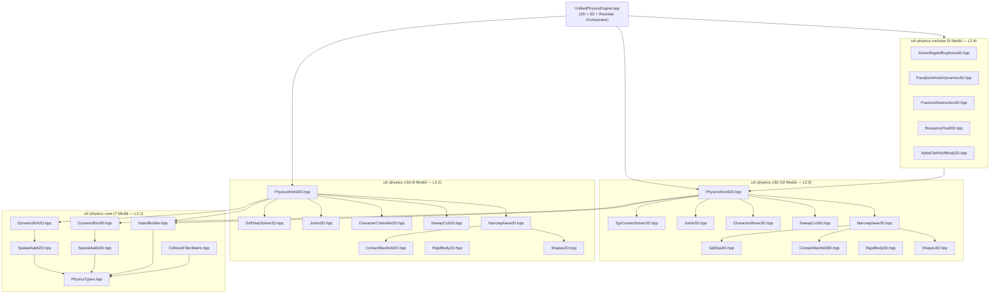

# ADR-20261018-rockstar-2d-3d-modular-physics-engine: CHROMODYNAMIC 32-Modüllü 2D & 3D Birleşik Fizik Motoru Mimarisi (`cd::physics::core`, `cd::physics::v2d`, `cd::physics::v3d`, `cd::physics::rockstar`)

- **Status**: Accepted (Supersedes / Extends `ADR-008-physics-architecture` Native Modular Tier)
- **Date**: 2026-10-18
- **Layer Rank**: Level 2 / Level 3 (`engine/world/physics` — `cd::physics::core`, `cd::physics::v2d`, `cd::physics::v3d`, `cd::physics::rockstar`, `cd::physics::UnifiedPhysicsEngine`)
- **Subsystems**: `engine/world/physics`, `engine/world/physics_jolt`, `engine/world/physics_vehicle`, `engine/world/physics_soft_body`, `engine/world/scene`, `apps/editor`

---

## 1. Bağlam & Motivasyon (Context & Reference Engines)

Modern AAA açık dünya ve hibrit 2B/3B oyun motorlarında fizik alt-sistemi; yalnızca basit katı cisim çarpışmalarını çözmekle kalmayıp **aktif biyomekanik karakter dengesi**, **lastik-zemin mikro-kayma ve şasi deformasyonu**, **hücresel Voronoi yıkımı**, **hidrostatik/hidrodinamik kaldırma kuvveti** ve **yüksek kütle oranlı (1000:1) kararlı yığınlama** görevlerini tek bir deterministik çatı altında yürütmek zorundadır.

Monolitik "tek dev dosya" (`PhysicsWorld.hpp` içinde 5.000+ satır) veya birbirine sıkı bağlı soyutlama katmanları; derleme sürelerini şişirmekte, birim test izolasyonunu zorlaştırmakta ve 2B ile 3B dünyaların ortak veri yapılarını (`BodyHandle`, `CollisionFilterMatrix`, `IslandBuilder`, `MaterialCombinePolicy`) paylaşmasını engellemektedir.

CHROMODYNAMIC'in yeni nesil birleşik 2B+3B fizik mimarisi, endüstrideki **beş referans fizik motorunun** en güçlü algoritmik çekirdeklerini **"1 Sorumluluk = 1 Küçük Modüler `.hpp` Dosyası"** (toplam **32 granüler modül**) kuralıyla sentezler:

1. **Rockstar RAGE Physics + NaturalMotion Euphoria (`GTA IV / GTA V / Red Dead Redemption 2`)**:
   - **Biyomekanik Aktif Ragdoll & PD Kas Torkları**: İskelet eklemleri animasyon pozuna körü körüne kilitlenmez; her eklem açısal konum/hız hatasını oransal-türev (PD) kontrolcüsüyle ($\tau = k_p (\theta_{\text{target}} - \theta) - k_d \dot{\theta}$) sürer ve darbe anında kas sertliğini ($k_p$) dinamik olarak düşürerek doğal tökezleme/tutunma tepkisi üretir.
   - **Capture Point (ZMP — Zero Moment Point) Denge & Otomatik Adımlama**: Karakterin kütle merkezi ($\mathbf{x}_{\text{com}}, \dot{\mathbf{x}}_{\text{com}}$) ters sarkaç modeliyle izlenir:
     $$\mathbf{x}_{\text{cp}} = \mathbf{x}_{\text{com}} + \sqrt{\frac{z_0}{g}}\,\dot{\mathbf{x}}_{\text{com}}$$
     Capture Point destek poligonunun dışına çıktığında telafi edici adım hedefi (stepping reflex) ve rüzgar/patlama şokuna karşı kollarla koruma (brace-for-impact) refleksi devreye girer.
   - **Pacejka "Magic Formula" Araç Dinamiği & Şasi Deformasyonu**: Raycast/süspansiyon tekerlekleri, boyuna ($\kappa$) ve yanal ($\alpha$) kayma oranlarını $F = D \sin(C \arctan(B x - E(Bx - \arctan(Bx))))$ eğrisiyle çözer; yüksek enerjili çarpışmalarda darbe impulsu şasi düğüm kafesini plastik olarak büker ve tekerlek kamber/toe hizasını bozar.
2. **Jolt Physics (`Guerrilla Games — Horizon Forbidden West / Death Stranding 2`, Jorrit Rouwe)**:
   - **6-DOF TGS (Temporal Gauss-Seidel) + Warm-Starting Çözücü**: Büyük zaman adımını ($\Delta t$) $N_s$ alt-adıma ($\delta t = \Delta t / N_s$) bölerek her alt-adımda küçük açılı konum entegrasyonu yapar; yüksek kütle oranlarında (ör. hafif kutu üzerinde ağır konteyner) yaylanma ve patlamayı ortadan kaldırır.
   - **`CharacterVirtual` Collide-and-Slide**: Dinamik katı cisimlerin FPS titreşimine (jitter) kapılmadan merdiven çıkma (`step_up`), eğim sınırı (`max_slope_angle`), hareketli platform takibi ve sahte yerçekimi/duvar yürümesi sağlayan kinematik süpürme (sweep) tabanlı karakter hareketlendiricisi.
   - **Dynamic AABB BVH**: $O(\log N)$ yüzey alanı sezgiseli (SAH) ve şişirilmiş (fattened) AABB yapraklarıyla minimum ağaç yeniden-inşa maliyeti.
3. **Source 2 Rubikon (`Valve — Half-Life: Alyx / Counter-Strike 2`)**:
   - Konveks çokyüzlüler (hull) arasında kararlı **GJK + Expanding Polytope Algorithm (EPA)** ve yüz-yüz temas manifoldu (4 noktalı ufuk kırpma) üretimi ile Voronoi kırılma yüzeylerinin anlık dar-faz entegrasyonu.
4. **NVIDIA PhysX 5 & Extended Position-Based Dynamics (`Macklin et al., XPBD`)**:
   - Zaman adımından ve iterasyon sayısından bağımsız **uyumluluk (compliance $\tilde{\alpha} = \alpha / \delta t^2$)** matrisiyle çözülen mesafe, bükülme (dihedral bend) ve hacim koruma kısıtları; rüzgar kaldırma/sürükleme aerodinamiği ve katı cisimlerle çift yönlü darbe etkileşimi.
5. **Box2D v3 (`Erin Catto — Soft-Step Solver`)**:
   - Klasik Baumgarte stabilizasyonunun enerji ekleyen yapay sıçrama hatasını ortadan kaldıran **harmonik sönümlü yumuşak kısıt (Soft-Step) formülasyonu**: frekans ($\omega = 2\pi f$) ve sönüm oranı ($\zeta$) üzerinden türetilen konum/hız ağırlık katsayıları, spekülatif sürekli çarpışma tespiti (Speculative + Bisection TOI CCD) ve birleşik darbe grafiği adalandırması (`IslandBuilder`).

---

## 2. Reddedilen Alternatifler & Karşılaştırmalı SOTA Analizi (Alternatives Considered)

| Değerlendirme Kriteri | Alternatif A: Monolitik Tek-Dosya / Tek-Sınıf Fizik Motoru | Alternatif B: Yalnızca Harici C/C++ Kütüphane Sarmalayıcıları (Opaque Vendor Lock) | **Seçilen Mimari: CHROMODYNAMIC 32-Modüllü Birleşik 2D+3D & Rockstar/Jolt/Box2Dv3 Fizik Motoru** |
| :--- | :--- | :--- | :--- |
| **Modülerlik & Sorumluluk Sınırı** | Zayıf. Geniş faz, dar faz, çözücü, eklemler ve araç fiziği tek başlıkta toplanır; küçük bir değişiklik tüm dünyayı yeniden derletir. | Orta. Harici kütüphane başlıkları sızıntı yapmasın diye ağır PIMPL ve çift kopyalama (adaptör çevirisi) gerekir. | **Katı Granüler Modülerlik (32 `.hpp` Modülü)**. Her veri yapısı ve algoritma (BVH, GJK-EPA, TGS, Soft-Step, Euphoria Ragdoll, Pacejka Araç) kendi bağımsız, küçük `.hpp` dosyasındadır. |
| **2B ve 3B Altyapı Paylaşımı** | 2B ve 3B tamamen kopuk iki ayrı kod tabanı olarak yazılır; filtreleme ve uyku adası (island) mantığı kopyalanır. | Box2D ve Jolt/PhysX tamamen farklı handle, katman maskesi ve materyal birleştirme semantiği kullanır. | **Ortak `cd::physics::core` Katmanı (7 Modül)**. `BodyHandle`, `CollisionFilterMatrix`, `IslandBuilder` ve materyal kuralları 2B (`v2d`) ve 3B (`v3d`) arasında %100 paylaşılır. |
| **Yüksek Kütle Oranı & Yığın Kararlılığı** | Klasik PGS + Baumgarte çözücü 20+ kutu yığınında veya 100:1 kütle oranında titrer ve enerji üretir. | Jolt iyi çözer ancak motor içi özel 2B/3B hibrit kısıtlara doğrudan erişim sınırlıdır. | **2B'de Box2D v3 Soft-Step ($\omega, \zeta$), 3B'de Jolt 6-DOF Sub-Stepped TGS + Warm-Starting**. Sıfır yapay enerji patlaması. |
| **Aktif Ragdoll, Araç Deformasyonu & Yıkım** | Standart fizik motorlarında bulunmaz; oyun kodunda ad-hoc yamalarla yazılır. | Açık kaynak Jolt/Box2D'de Euphoria ZMP denge veya Pacejka şasi plastik deformasyonu yerleşik değildir. | **`cd::physics::rockstar` Katmanı (5 Modül)**. Euphoria aktif ragdoll, Pacejka araç + şasi bükülmesi, Voronoi kırılma, Arşimet kaldırma kuvveti ve XPBD kumaş birinci sınıf modüldür. |
| **C++23 Tip Güvenliği & Determinizm** | Ham işaretçiler (`RigidBody*`), belirsiz sahiplik ve kontrolsüz istisnalar. | C99 / C++17 API kalıpları. | **%100 C++23 (`[[nodiscard]]`, `noexcept`, `std::expected`, Jenerasyonel `Handle`)** + sabit zaman adımlı deterministik `IslandBuilder`. |

- **Alternatif A (Monolitik Fizik Başlığı) Neden Reddedildi?**: 2B ve 3B çözücüleri, GJK/EPA geometrisini ve Rockstar seviyesi simülasyonları tek bir dosyaya yığmak "God Object" anti-desenine yol açar; bağımsız birim test (`cd_test_physics`) ve başlık yalıtımı ilkelerini ihlal eder.
- **Alternatif B (Yalnızca Kapalı Adaptör Sarmalayıcı) Neden Reddedildi?**: `ADR-008` kapsamında tanımlanan `cd::physics_jolt` adaptörü korunmakla birlikte, CHROMODYNAMIC'in `ElementCapsuleTree` (`ADR-20261018`) ile sıfır-kopya çalışan, eğitim/araştırma/oynanış için her aşaması şeffaf ve özelleştirilebilir yerel 32-modüllü C++23 fizik çekirdeğine sahip olması stratejik bir gerekliliktir.

---

## 3. Karar: "1 Sorumluluk = 1 Küçük Modüler `.hpp` Dosyası" (32 Modüllü Birleşik Mimari)

Fizik motoru `engine/world/physics/include/cd/physics/` altında dört alt-alan (`core`, `v2d`, `v3d`, `rockstar`) ve bir üst-seviye birleşik orkestratör (`UnifiedPhysicsEngine.hpp`) olmak üzere toplam **32 tek-sorumluluklu `.hpp` modülüne** ayrılmıştır.

### 3.1 Mimari Bağımlılık Grafiği (DAG)



---

### 3.2 Katman 1: `cd::physics::core` — 2B & 3B Ortak Temel Altyapı (7 Modül)

| # | Modül Yolu (`include/cd/physics/...`) | Tekil Sorumluluk & Algoritmik Kontrat |
| :-: | :--- | :--- |
| **1** | `core/PhysicsTypes.hpp` | Güçlü tipli jenerasyonel tanıtıcılar (`BodyHandle`, `ShapeHandle`, `JointHandle`, `RagdollHandle`, `VehicleHandle`), `BodyMotionType` (`kStatic`, `kKinematic`, `kDynamic`), `PhysicsMaterial` (`friction`, `restitution`, `density`, `MaterialCombineMode`), `SleepSettings`, `SubStepConfig` ve istisnasız hata kodları (`PhysicsError` + `std::expected`). |
| **2** | `core/CollisionFilterMatrix.hpp` | 16x16 bit-maskeli çarpışma katmanı matrisi (`ObjectLayer`), grup/maske kuralı ve Jolt tarzı `BroadPhaseLayer` (`NonMoving`, `Moving`, `Sensor`, `Debris`) çift yönlü hızlı filtreleme tablosu. |
| **3** | `core/SpatialAabb2D.hpp` | 2B eksen-hizalı sınırlayıcı kutu (`Vec2f min, max`), çevre uzunluğu (2B SAH metriği), kapsama, kesişim, hız-genişletmeli şişirme (`fatten_for_displacement`) ve Liang-Barsky 2B ışın-kutu kesişimi. |
| **4** | `core/SpatialAabb3D.hpp` | 3B eksen-hizalı sınırlayıcı kutu (`Vec3f min, max`), yüzey alanı ($2(dx\,dy + dy\,dz + dz\,dx)$ SAH metriği), kapsama, kesişim, hız-genişletmeli şişirme ve slab-tabanlı 3B ışın-kutu kesişimi. |
| **5** | `core/DynamicBvh2D.hpp` | Box2D v3 tarzı yüzey-çevresi sezgisel (SAH) maliyetli, AVL ağaç rotasyonu ile dengelenen dinamik 2B AABB hiyerarşisi (`insert_proxy`, `move_proxy`, `query_aabb`, `raycast`). |
| **6** | `core/DynamicBvh3D.hpp` | Jolt Physics tarzı yüzey-alanı sezgisel (SAH) maliyetli, 3B şişirilmiş AABB yapraklı dinamik geniş-faz (broadphase) ağacı (`insert_proxy`, `move_proxy`, `query_aabb`, `raycast`). |
| **7** | `core/IslandBuilder.hpp` | Aktif dinamik gövdeleri temas ve eklem kenarları üzerinden birleşik küme bulma (Union-Find / DFS) ile uyku adalarına (`SimulationIsland`) ayıran, durağan adaları otomatik uyutan (`put_to_sleep`) ve darbe anında komşu adayı uyandıran (`wake_island`) deterministik graf bölücü. |

---

### 3.3 Katman 2: `cd::physics::v2d` — Box2D v3 Kalitesinde 2B Planar Fizik Motoru (9 Modül)

| # | Modül Yolu (`include/cd/physics/...`) | Tekil Sorumluluk & Algoritmik Kontrat |
| :-: | :--- | :--- |
| **8** | `v2d/Shapes2D.hpp` | `CircleShape2D`, `CapsuleShape2D`, `BoxShape2D`, `ConvexPolygon2D` (maks 8 köşe + dışa dönük normal doğrulaması) ve `SegmentShape2D` (tek/çift taraflı hayalet kenar korumalı çizgi) + analitik 2B kütle/atalet momenti ($I_{zz}$) hesabı. |
| **9** | `v2d/ContactManifold2D.hpp` | Maksimum 2 temas noktalı 2B manifold (`ContactPoint2D`), geometrik özellik anahtarı (`FeaturePairKey2D`) ve kareler arası sıcak-başlatma (warm-starting) darbe önbelleği (`normal_impulse`, `tangent_impulse`). |
| **10** | `v2d/Narrowphase2D.hpp` | Analitik Daire-Daire, Daire-Kapsül, Daire-Kutu, Kapsül-Kapsül ve Ayrım Ekseni Teoremi (SAT + Sutherland-Hodgman referans/gelen kenar kırpması) ile Poligon/Kutu 2B dar-faz çarpışma üreticisi. |
| **11** | `v2d/SweepCcd2D.hpp` | Yüksek hızlı 2B mermi/cisimler için 2B ışın-şekil kesişimi, şekil süpürme (`shape_cast_2d`) ve ikiye bölme (bisection) tabanlı Sürekli Çarpışma Tespiti (TOI — Time of Impact) ile tünelleme önleyici. |
| **12** | `v2d/RigidBody2D.hpp` | 2B katı cisim durumu (`position`, `rotation_rad`, `linear_velocity`, `angular_velocity`, `inv_mass`, `inv_inertia`, `gravity_scale`, eksen kilitleme `lock_rotation`) ve yarı-örtük (semi-implicit) Euler kuvvet entegratörü. |
| **13** | `v2d/SoftStepSolver2D.hpp` | Erin Catto Box2D v3 **Soft-Step** harmonik kısıt çözücüsü: Baumgarte sertliği yerine doğal frekans ($f_{\text{Hz}}$) ve sönüm oranı ($\zeta$) üzerinden yumuşak hız/konum düzeltmesi, sıcak-başlatma, Coulomb sürtünme konisi ve esneklik (restitution) eşiği. |
| **14** | `v2d/Joints2D.hpp` | 2B mekanik kısıtlar: `DistanceSpringJoint2D` (sönümlü yay), `RevoluteHingeJoint2D` (motor + açı limiti), `PrismaticSliderJoint2D` (doğrusal ray + motor) ve `WheelSuspensionJoint2D` (2B araç süspansiyonu). |
| **15** | `v2d/CharacterController2D.hpp` | Platform/aksiyon oyunları için kinematik 2B kapsül/kutu karakter kontrolcüsü: `move_and_slide`, maksimum tırmanma açısı, zemin yakalama (`snap_to_ground`), tek-yönlü platform geçişi ve 2B çatı/duvar kayması. |
| **16** | `v2d/PhysicsWorld2D.hpp` | 2B fizik dünyası yöneticisi: `DynamicBvh2D` geniş-faz, `Narrowphase2D`, `IslandBuilder`, `SweepCcd2D` ve alt-adımlı (`substep`) `SoftStepSolver2D` boru hattını tek `step(dt)` çağrısında çalıştıran konteyner. |

---

### 3.4 Katman 3: `cd::physics::v3d` — Jolt + Rubikon Kalitesinde 3B Uzamsal Fizik Motoru (10 Modül)

| # | Modül Yolu (`include/cd/physics/...`) | Tekil Sorumluluk & Algoritmik Kontrat |
| :-: | :--- | :--- |
| **17** | `v3d/Shapes3D.hpp` | `SphereShape3D`, `CapsuleShape3D`, `CylinderShape3D`, `BoxShape3D`, `ConvexHullShape3D` (destek fonksiyonu `get_support`), `TriangleMeshShape3D` ve `HeightFieldShape3D` (2B yükseklik ızgarası) + analitik 3x3 simetrik eylemsizlik tensörü (`InertiaTensor3D`). |
| **18** | `v3d/ContactManifold3D.hpp` | Maksimum 4 temas noktalı 3B temas yaması (`ContactManifold3D`), en derin penetrasyon noktasını koruyan alan-maksimize edici 4-nokta azaltma (manifold reduction) ve normal + çift teğet (`tangent1`, `tangent2`) warm-start darbe önbelleği. |
| **19** | `v3d/GjkEpa3D.hpp` | Genel dışbükey (convex) 3B şekiller için Minkowski farkı üzerinde Gilbert-Johnson-Keerthi (GJK) mesafe/kesişim algoritması ve iç içe geçme durumunda Expanding Polytope Algorithm (EPA) ile temas normali ve derinlik çıkarımı. |
| **20** | `v3d/Narrowphase3D.hpp` | Analitik Küre-Küre, Küre-Kapsül, Kapsül-Kapsül (en yakın doğru parçası çifti), Küre-Kutu, Kutu-Kutu (15 eksenli 3B SAT + yüz kırpma), Yükseklik Alanı (HeightField) ve `GjkEpa3D` hibrit 3B dar-faz çarpışma dağıtıcısı. |
| **21** | `v3d/SweepCcd3D.hpp` | 3B analitik/GJK ışın izleme (`raycast_3d`), dışbükey şekil süpürme (`shape_cast_3d`) ve yüksek hızlı 3B cisimler için spekülatif temas + muhafazakar ilerleme (conservative advancement) tabanlı 3B CCD. |
| **22** | `v3d/RigidBody3D.hpp` | 3B katı cisim durumu (`position`, birim kuaterniyon `orientation`, `linear_velocity`, `angular_velocity`, yerel `inv_inertia_local` ve dünya uzayına döndürülmüş `inv_inertia_world = R * I_inv * R^T` tensörü, jiroskopik tork entegrasyonu ve 6-DOF eksen kilitleri). |
| **23** | `v3d/TgsContactSolver3D.hpp` | Jolt Physics tarzı **6-DOF Temporal Gauss-Seidel (TGS)** alt-adımlı temas çözücüsü: efektif kütle matrisi, sıcak-başlatma, ortonormal çift teğet uzayında izotropik Coulomb sürtünme konisi ve yumuşak konum gevşetmesi. |
| **24** | `v3d/Joints3D.hpp` | 3B mekanik eklemler: `PointBallSocketJoint3D`, `HingeRevoluteJoint3D` (açı limiti + motor), `SliderPrismaticJoint3D`, `ConeTwistRagdollJoint3D` (anatomik koni + burulma limiti) ve `SixDofSpringJoint3D` (6 eksenli yay/motor). |
| **25** | `v3d/CharacterMover3D.hpp` | Jolt `CharacterVirtual` mimarisinde kinematik 3B kapsül hareketlendirici: çoklu-süpürme `collide_and_slide`, otomatik basamak çıkma (`step_up_height`), dik yamaç kaydırma (`max_slope_angle_rad`), zemin normali takibi ve hareketli platform hız mirası. |
| **26** | `v3d/PhysicsWorld3D.hpp` | 3B fizik dünyası yöneticisi: `DynamicBvh3D`, `Narrowphase3D`, `SweepCcd3D`, `IslandBuilder` ve `TgsContactSolver3D` alt sistemlerini deterministik sabit zaman adımıyla orkestre eden ana 3B dünya sınıfı. |

---

### 3.5 Katman 4: `cd::physics::rockstar` — RAGE / Euphoria / PhysX 5 İleri Simülasyon Modülleri (5 Modül)

| # | Modül Yolu (`include/cd/physics/...`) | Tekil Sorumluluk & Algoritmik Kontrat |
| :-: | :--- | :--- |
| **27** | `rockstar/ActiveRagdollEuphoria3D.hpp` | **Rockstar Euphoria Biyomekanik Aktif Ragdoll**: Eklem başına oransal-türev (PD) kas motoru ($\tau = k_p \Delta\theta - k_d \dot{\theta}$), ters sarkaç **Capture Point (ZMP)** hesaplaması ($\mathbf{x}_{\text{cp}} = \mathbf{x}_{\text{com}} + \sqrt{z_0/g}\,\dot{\mathbf{x}}_{\text{com}}$), dengesini kaybedince otomatik adım atma (procedural stepping reflex), mermi/patlama darbesinde bölgesel kas gevşemesi (hit-reaction) ve düşerken elleri öne uzatma (protective brace) davranış sentezi. |
| **28** | `rockstar/PacejkaVehicleDynamics3D.hpp` | **Rockstar GTA V / IV Araç Fiziği & Deformasyonu**: 4+ tekerlekli yay-amortisör ışın/kapsül süspansiyonu, yanal/boyuna kayma açıları için **Pacejka Magic Formula** lastik kuvveti, Ackermann direksiyon geometrisi, diferansiyel/şanzıman tork eğrisi, devrilme önleyici denge çubuğu (anti-roll bar) ve yüksek enerjili çarpışmalarda şasi köşe kafesini kalıcı olarak büken **plastik çarpışma deformasyon ızgarası**. |
| **29** | `rockstar/FractureDestruction3D.hpp` | **Voronoi Hücresel Kırılma & Yıkım**: Darbe noktasındaki ($p_{\text{impact}}$) impuls büyüklüğü malzeme kırılma eşiğini ($J_{\text{fracture}}$) aştığında gövdeyi 3B Voronoi tohum noktalarına göre gerçek zamanlı dışbükey parçalara (`ConvexShard3D`) bölen, iç bağlantı grafiğini (connectivity graph) güncelleyen ve kopan adaları bağımsız `RigidBody3D` olarak fırlatan yıkım motoru. |
| **30** | `rockstar/BuoyancyFluid3D.hpp` | **Hidrostatik & Hidrodinamik Su Etkileşimi**: 3B gövdeleri veya araç/gemileri su yüzeyi yüksekliğine (düzlem veya FFT dalga fonksiyonu) göre çoklu-voksel/dörtyüzlü hacim elemanlarına bölerek batık hacim üzerinden Arşimet kaldırma kuvveti ($\mathbf{F}_b = -\rho_{\text{fluid}} V_{\text{sub}} \mathbf{g}$), doğrusal/karesel su direnci (drag) ve yanal yüzeye etkiyen akıntı torklarını hesaplayan çözücü. |
| **31** | `rockstar/XpbdClothSoftBody3D.hpp` | **Extended Position-Based Dynamics (XPBD) Kumaş, Halat & Yumuşak Gövde**: Uyumluluk ($\tilde{\alpha} = \alpha / \delta t^2$) tabanlı mesafe (stretch), çapraz makaslama (shear), dihedral bükülme (bend) ve dörtyüzlü hacim koruma ($\det(F) = 1$) kısıtları; aerodinamik rüzgar kaldırma/sürükleme üçgen kuvvetleri ve 3B kapsül/küre gövdelerle öz-çarpışma/dış-çarpışma çözümü. |

---

### 3.6 Katman 5: `UnifiedPhysicsEngine.hpp` — 2B + 3B + Rockstar Birleşik Orkestratör (Modül #32)

32. modül olan `include/cd/physics/UnifiedPhysicsEngine.hpp`, tüm 2B (`PhysicsWorld2D`), 3B (`PhysicsWorld3D`) ve ileri seviye `rockstar` alt-sistemlerini tek bir deterministik zamanlayıcı, ortak olay kuyruğu (`ContactEvent2D`, `ContactEvent3D`, `FractureEvent3D`, `RagdollBalanceState`) ve `ADR-20261018` `ElementCapsuleTree` senkronizasyon köprüsü altında birleştirir:

```cpp
#pragma once

#include <cd/physics/core/PhysicsTypes.hpp>
#include <cd/physics/rockstar/ActiveRagdollEuphoria3D.hpp>
#include <cd/physics/rockstar/BuoyancyFluid3D.hpp>
#include <cd/physics/rockstar/FractureDestruction3D.hpp>
#include <cd/physics/rockstar/PacejkaVehicleDynamics3D.hpp>
#include <cd/physics/rockstar/XpbdClothSoftBody3D.hpp>
#include <cd/physics/v2d/PhysicsWorld2D.hpp>
#include <cd/physics/v3d/PhysicsWorld3D.hpp>

#include <expected>

namespace cd::physics
{

struct UnifiedStepTelemetry
{
    std::uint32_t active_bodies_2d { 0U };
    std::uint32_t active_bodies_3d { 0U };
    std::uint32_t sleeping_islands_2d { 0U };
    std::uint32_t sleeping_islands_3d { 0U };
    std::uint32_t active_ragdolls { 0U };
    std::uint32_t active_vehicles { 0U };
    std::uint32_t fractured_shards { 0U };
    std::uint32_t xpbd_particles { 0U };
};

class UnifiedPhysicsEngine
{
public:
    UnifiedPhysicsEngine() noexcept = default;

    [[nodiscard]] v2d::PhysicsWorld2D& world_2d() noexcept { return world_2d_; }
    [[nodiscard]] const v2d::PhysicsWorld2D& world_2d() const noexcept { return world_2d_; }

    [[nodiscard]] v3d::PhysicsWorld3D& world_3d() noexcept { return world_3d_; }
    [[nodiscard]] const v3d::PhysicsWorld3D& world_3d() const noexcept { return world_3d_; }

    [[nodiscard]] rockstar::ActiveRagdollSystem3D& ragdolls() noexcept { return ragdolls_; }
    [[nodiscard]] rockstar::PacejkaVehicleSystem3D& vehicles() noexcept { return vehicles_; }
    [[nodiscard]] rockstar::FractureDestructionSystem3D& destruction() noexcept { return destruction_; }
    [[nodiscard]] rockstar::BuoyancyFluidSystem3D& buoyancy() noexcept { return buoyancy_; }
    [[nodiscard]] rockstar::XpbdSoftBodySystem3D& soft_bodies() noexcept { return soft_bodies_; }

    /// Advances 2D Soft-Step, 3D TGS, Euphoria Active Ragdoll, Pacejka Vehicle,
    /// Buoyancy, Voronoi Fracture, and XPBD Soft-Body pipelines in deterministic order.
    [[nodiscard]] std::expected<UnifiedStepTelemetry, core::PhysicsError> step_all(
        float dt_seconds,
        std::uint32_t substeps = 4U) noexcept;

private:
    v2d::PhysicsWorld2D                 world_2d_ {};
    v3d::PhysicsWorld3D                 world_3d_ {};
    rockstar::ActiveRagdollSystem3D     ragdolls_ {};
    rockstar::PacejkaVehicleSystem3D    vehicles_ {};
    rockstar::FractureDestructionSystem3D destruction_ {};
    rockstar::BuoyancyFluidSystem3D     buoyancy_ {};
    rockstar::XpbdSoftBodySystem3D      soft_bodies_ {};
};

} // namespace cd::physics
```

---

## 4. Katman (Layer DAG) Uyumu, Sonuçlar & Doğrulama Planı (Consequences & Verification)

### 4.1 Katman (Layer DAG) Uyumu

`check_layer_dag.py` tarafından denetlenen CHROMODYNAMIC mimarisinde 32 modülün tamamı `engine/world/physics` altında konumlanır ve yalnızca `Level 0` (`cd::core`, `cd::math`, `cd::memory`) bağımlılıklarını içerir; hiçbir modül `render`, `ui` veya `editor` katmanlarına yukarı-yönlü `#include` yapmaz:

```text
Level 0: foundation (cd::core, cd::math, cd::memory, cd::platform)
Level 1: concurrency, io (cd::jobs, cd::vfs)
Level 2: physics (cd::physics::core, cd::physics::v2d, cd::physics::v3d, cd::physics::rockstar, cd::physics::UnifiedPhysicsEngine)
Level 3: world/scene (cd::scene::ElementCapsuleTree — KineticBody3D, KineticBody2D, Avatar, RoverVessel, ShatterMesh3D, ClothSurface3D)
Level 4: runtime & gameplay (cd::gameplay_vessel, cd::gameplay_pilot)
Level 5: apps/editor (CHROMODYNAMIC Studio) & apps/player (cd_player)
```

### 4.2 Olumlu Sonuçlar (Positive Consequences)

1. **Sıfır Monolitik Şişme ("1 Sorumluluk = 1 Küçük `.hpp` Dosyası")**: 32 modülün her biri yalnızca kendi dar sorumluluğunu (ör. `GjkEpa3D.hpp` yalnızca dışbükey GJK/EPA mesafesini, `SoftStepSolver2D.hpp` yalnızca 2B harmonik darbe çözümünü) içerir. Bir geliştirici yalnızca 2B geniş-faz AABB ağacına ihtiyaç duyduğunda tüm 3B/Rockstar çözücülerini derlemek zorunda kalmaz (`pay-only-for-what-you-use`).
2. **Mevcut Geriye-Dönük Uyumluluk (`IPhysicsWorld` & `JoltWorld`)**: Mevcut `cd::physics::IPhysicsWorld`, `Aabb.hpp`, `Sphere.hpp`, `Capsule.hpp`, `Obb.hpp` ve `cd::physics_jolt` hedefleri kırılmadan korunur; 32 yeni granüler modül bunlarla tam uyumlu çalışır.
3. **AAA Fizik Kalitesi**:
   - **2B**: Box2D v3 Soft-Step çözücüsü + spekülatif TOI CCD ile sıfır titremeli 2B yığınlama ve platform karakter kontrolü.
   - **3B**: Jolt 6-DOF alt-adımlı TGS çözücüsü + GJK/EPA + `CharacterMover3D` collide-and-slide.
   - **Rockstar / Euphoria Katmanı**: Capture Point (ZMP) dengeli aktif ragdoll, Pacejka Magic Formula lastik + plastik şasi deformasyonu, darbe enerjili 3B Voronoi yıkımı, çoklu-hücreli Arşimet kaldırma kuvveti ve XPBD kumaş/yumuşak gövde.

### 4.3 Doğrulama Planı (Verification Matrix)

- **Birim Test Hedefi (`cd_test_physics`)**:
  1. `[Core]` `CollisionFilterMatrix` katman kuralları, `DynamicBvh2D` / `DynamicBvh3D` SAH ağaç dengeleme + ışın izleme ve `IslandBuilder` uyku/uyanma geçişleri.
  2. `[2D Engine]` `Narrowphase2D` (Daire/Kapsül/Kutu/Poligon SAT), `SweepCcd2D` yüksek hızlı mermi TOI, `SoftStepSolver2D` çoklu-kutu yığın kararlılığı, `Joints2D` ve `CharacterController2D` eğim/merdiven hareketi.
  3. `[3D Engine]` `GjkEpa3D` dışbükey kesişim + penetrasyon vektörü, `Narrowphase3D`, `SweepCcd3D`, `TgsContactSolver3D` 100:1 kütle oranı kararlılığı, `Joints3D` ve `CharacterMover3D` basamak/yamaç testi.
  4. `[Rockstar Tier]` `ActiveRagdollEuphoria3D` ZMP Capture Point adım refleksi + darbe tepkisi, `PacejkaVehicleDynamics3D` hızlanma/viraj kayma açısı + çarpışma şasi deformasyonu, `FractureDestruction3D` Voronoi parça üretimi + kütle korunumu, `BuoyancyFluid3D` Arşimet denge su seviyesi ve `XpbdClothSoftBody3D` kumaş sarkma + rüzgar testi.
  5. `[Unified]` `UnifiedPhysicsEngine::step_all` 2B + 3B + Rockstar eşzamanlı adım telemetrisi.
- **Katman DAG Denetimi**:
  `python "C:/Users/cemal/.gemini/config/plugins/argon-core/skills/engine-sota-adr/scripts/check_layer_dag.py" --engine-root engine`
