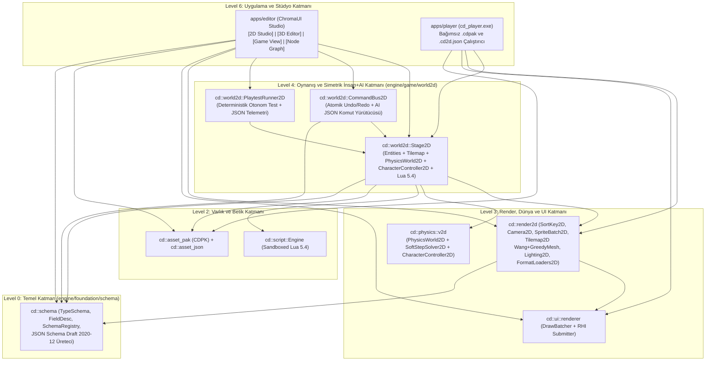

# ADR-20261111-commercial-2d-3d-ai-native-architecture: Ticari 2D-Öncelikli, 3D/HD-2D Birleşik ve İnsan+AI Simetrik Oyun Motoru Mimarisi (`cd::schema`, `cd::render2d`, `cd::world2d`)

- **Status**: Accepted
- **Date**: 2026-11-11
- **Layer Rank**: Level 0 (`engine/foundation/schema`), Level 3 (`engine/render/render2d`), Level 4 (`engine/game/world2d`), Level 6 (`apps/editor`, `apps/player`)
- **Subsystems**: `engine/foundation/schema`, `engine/render/render2d`, `engine/game/world2d`, `engine/world/physics/v2d`, `engine/script`, `engine/ui/widgets`, `apps/editor`, `apps/player`

***

## 1. Bağlam ve Mevcut Sistem Tanısı (Context & Root-Cause Diagnosis)

`CHROMODYNAMIC_ENGINE` (`v0.99.93`) kod tabanı üzerinde yapılan uçtan uca statik ve çalışma zamanı incelemesi, motorun güçlü alt-seviye C++23 yapı taşlarına sahip olduğunu kanıtlamıştır: Vulkan 1.3 bindless ve donanım ışın izleme (`cd::rhi_vulkan`), sıfır Dear ImGui bağımlılıklı yerel GPU arayüzü (`ChromaUi` + `DrawBatcher` + `Submitter`), 32 modüllü 2D/3D fizik çekirdeği (`cd::physics::v2d::PhysicsWorld2D` + `CharacterController2D`) ve kum-havuzlu Lua 5.4 sanal makinesi (`cd::script::Engine`).

Buna karşın motorun gerçek bir **ticari oyun üretim stüdyosu** olmasını engelleyen beş yapısal kopukluk tespit edilmiştir:

1. **Üçlü Mimari Bölünme (Triple Split-Brain)**:
   - `apps/editor` (`CMakeLists.txt:14-88`), `engine/` altındaki `cd::runtime`, `cd::scene_renderer`, `cd::element_core`, `cd::elements_domain` veya `cd::physics::v2d` kütüphanelerini bağlamaz; kendi izole 3D OBB çözücüsünü (`StudioPhysicsSolver.hpp`) çalıştırır.
   - `apps/player/main.cpp` (`L518-640`), `EngineLoop` döngüsünü `NullDevice` üzerinde koşturur ve 3D sahneyi CPU tel-kafes izdüşümüyle taklit eder; `SceneRenderer.cpp` (`L656-783`) içindeki 19 FrameGraph geçişinin yürütme gövdeleri boştur (`pass.execute =  {};`).
   - `engine/world/scene/include/cd/scene/constructs/` altındaki 250 sınıf yalnızca ~35 satırlık metaveri sarmalayıcısıdır.
2. **Birinci Hedef Olan 2D Motorun Eksikliği**:
   - `engine/render/` altında hiçbir 2D çizim kütüphanesi (`cd::render2d`) yoktur.
   - Editörde 2D düğüm veya 2D karakter oluşturulduğunda (`StudioNodeCatalog.hpp:209-216`, `StudioSceneBuilder.hpp:3493-3510`), sahneye ortografik 2D sprite yerine **yassılaştırılmış 3D küp** (`PrimitiveKind::kCube`, ölçek `{0.75, 1.05, 0.14}`) eklenir.
   - Tilemap fırçası, Wang otomatik döşeme (auto-tiling), birleşik çarpışma dikdörtgeni üretimi (greedy collider meshing), Flipbook kare animasyonu, 2D dinamik ışık/yumuşak gölge ve `.aseprite` / `.ldtk` yükleyicileri mevcut değildir.
3. **Kırık Bağımsız Dışa Aktarım ("F9 Yanılsaması")**:
   - `StudioSceneBuilder.hpp:3239-3264` içindeki `export_standalone_game_package`, bağımsız bir oyuncu ikilisi ve `.cdpak` arşivi üretmek yerine `..\..\ide-base\bin\editor.exe --scene ... --pie-play` çağrısı yapan bir `.bat` dosyası yazar. Başka bir bilgisayara kopyalandığında oyun çalışmaz.
4. **Yansıma Şeması (`cd::schema`) ve Tam Geri-Alma Eksikliği**:
   - `engine/foundation/CMakeLists.txt:19` satırında `# Sprint S2.9+ adds: schema (still ahead)` notuyla ertelenmiş olan şema katmanı olmadığı için her bileşen hem C++ yapısında, hem elle yazılmış `ChromaUi` kodunda, hem JSON kayıt/yükleme kodunda ayrı ayrı tekrarlanır. `EditHistory` yalnızca 3D Gizmo sürüklemelerini geri alır; nesne ekleme, silme, fayans boyama ve özellik düzenlemeleri geri alınamaz.
5. **İnsan ve Yapay Zeka (AI) İş Akışı Asimetrisi**:
   - Bir yapay zeka ajanının motorun veri tiplerini sıfır halüsinasyonla sorgulayabileceği `--dump-schema` çıktısı, hem insan UI işlemlerini (`Ctrl+Z`/`Ctrl+Y`) hem AI JSON komutlarını aynı atomik yoldan yürüten `CommandBus` katmanı ve deterministik oynanış telemetrisi (`PlaytestRunner`) bulunmamaktadır.

***

## 2. SOTA Karşılaştırması ve Reddedilen Alternatifler (Alternatives Considered)

| Kriter | Alternatif A: Mevcut 3D Editör İçinde Yassı Küplerle 2D Taklidi | Alternatif B: Yalnızca Harici Üçüncü-Parti 2D Araçlarına Bağımlılık | **Seçilen Mimari: Modüler `cd::schema` (L0) + `cd::render2d` (L3) + `cd::world2d` (L4) + Birleşik Studio/Player Hattı** |
| :-- | :-- | :-- | :-- |
| **Katman İzolasyonu (`check_layer_dag.py`)** | `apps/editor` başlıklarında sıkışmış, birim test edilemeyen monolitik kod. | Harici kütüphane sızıntıları ve format dönüşüm maliyeti. | **Sıfır DAG İhlali (`L0 -> L3 -> L4 -> L6`)**. Her modül bağımsız derlenir, test edilir (`cd_test_*`) ve hem Editör hem Player tarafından birebir aynı C++23 koduyla çalıştırılır. |
| **2D Görsel ve Fiziksel Kalite** | Perspektif bozulması, piksel titremesi (shimmer) ve sahte 3D OBB fiziği. | Fizik ve ışıklandırma motor dışına kopar. | **64-bit Radix Z/Y-Sort, Subpixel Smooth Kamera, 16-Tile Wang Auto-Tiling, Greedy Box2D v3 Soft-Step Collider Birleştirme, Analitik 2D Yumuşak Gölge**. |
| **İnsan + AI Ortak Üretim (Ergonomi)** | İnsan fareyle tıklar; AI ham JSON dosyalarını körü körüne düzenler ve bozar. | AI için ayrı betik dili, insan için ayrı arayüz. | **Simetrik `CommandBus2D` + `cd::schema`**. İnsan fırça/Inspector kullandığında da AI JSON komutu gönderdiğinde de aynı doğrulanmış, geri alınabilir (`Undo/Redo`) komut nesnesi çalışır. |
| **Bağımsız Dağıtım (Pipeline)** | `editor.exe` yoluna bağımlı kırık `.bat` betiği. | El ile dosya kopyalama. | **`PakBuilder` (`CDPK` `.cdpak`) + `cd_player.exe`**. Tek tıkla (`F9`) sahne ve varlıklar `.cdpak` içine paketlenir; `cd_player.exe` doğrudan paketi açıp çalıştırır. |

- **Alternatif A Neden Reddedildi?** 2D oyun geliştiricileri piksel-keskinliğinde ortografik kamera, alt-piksel pürüzsüz kaydırma, 16-parçalı otomatik fayans döşeme, kare-kare sprite animasyonu ve `coyote-time` / `jump-buffer` destekli 2D karakter kontrolcüsü bekler. Yassı 3D küplerle ticari 2D oyun yapılamaz.
- **Alternatif B Neden Reddedildi?** Harici editörlere zorunlu bağımlılık tam boru hattı hedefini bozar. Motor hem kendi yerleşik `[2D Studio]` çalışma alanına sahip olmalı hem de endüstri standardı `.aseprite` ve `.ldtk` dosyalarını doğrudan içe aktarabilmelidir.

***

## 3. Mimari Karar ve C++23 Modül Tasarımı (Decision & Public Contracts)

Mimari dönüşüm iki aşamalı ürün stratejisine göre yapılandırılmıştır:
- **1. Hedef (Tamamlanan Çekirdek ve Stüdyo)**: Ultra-gelişmiş 2D Oyun Motoru (`cd::schema` + `cd::render2d` + `cd::world2d` + `[2D Studio]` + `.cdpak`/`cd_player` bağımsız dağıtım hattı + AI Şema/Komut/Playtest protokolü).
- **2. Hedef (Birleşik 3D ve HD-2D Evrimi)**: `StageMode` (`Pure2D`, `HD2D`, `Pure3D`) altında 3D `SceneRenderer` GPU geçişlerinin `apps/editor` ve `apps/player` ile tekilleştirilmesi.

### 3.1 `cd::schema` (`engine/foundation/schema` - Level 0)

Tek doğruluk kaynağı olan tip ve özellik şeması kütüphanesidir. Yalnızca `cd::core` ve `cd::math` bağımlılığı taşır:
- `FieldKind`: `kBool`, `kInt32`, `kFloat`, `kVec2f`, `kVec3f`, `kColorRgba`, `kString`, `kAssetPath`, `kEnum`.
- `FieldDesc`: Alan adı, okunabilir etiket, açıklama (`tooltip`), sayısal sınırlar (`min_value`, `max_value`, `step`), sabit seçenek listesi (`enum_labels`) ve tip-güvenli okuma/yazma erişimcileri.
- `TypeSchema` ve `SchemaRegistry`: Kayıtlı tüm motor bileşenlerini ve komut şemalarını tutar; `export_json_schema()` çağrısıyla AI ajanları için standart **JSON Schema (Draft 2020-12)** belgesi üretir. Böylece hem `ChromaUi` Otomatik Inspector paneli hem AI doğrulama katmanı sıfır kod tekrarıyla aynı şemadan beslenir.

### 3.2 `cd::render2d` (`engine/render/render2d` - Level 3)

6 tek-sorumluluklu modüler başlıktan oluşur:
1. **`SortKey2D.hpp`**: 64-bit deterministik sıralama anahtarı:
   $$\text{Key}_{64} = (\text{Layer}_{8} \ll 56) \;\lor\; (\text{ZBias}_{16} \ll 40) \;\lor\; (\text{YSort}_{24} \ll 16) \;\lor\; \text{Material}_{16}$$
   Top-down RPG ve izometrik oyunlarda `y_sort` bayrağı açık nesneler dünya $Y$ taban koordinatına göre otomatik derinlik sırasına girer; aynı katmandaki nesneler doku/materyal kimliğine göre gruplanarak GPU çizim çağrısı (draw call) sayısını en aza indirir.
2. **`Camera2D.hpp`**: Piksel-keskinliğinde ortografik projeksiyon, alt-piksel sönümlü takip (`critically-damped spring`), hareket yönü ileri-bakış (`lookahead`), ölü-bölge (`deadzone`), sarsıntı (`trauma^2` ekran sarsıntısı) ve dünya-ekran dönüşümleri (`world_to_screen`, `screen_to_world`, `visible_world_bounds`).
3. **`SpriteBatch2D.hpp`**: `Sprite2D`, `FlipbookClip2D`, `FlipbookAnimator2D` (`Idle`, `Run`, `Jump`, `Fall` durum etiketleri), `NineSlice2D`, pivot, `flip_x`/`flip_y` ve görünür alan kırpması (frustum culling). Çıktısını doğrudan `cd::ui::renderer::DrawBatcher` üzerine yazar; böylece Vulkan 1.3 `Submitter` ve başsız (headless) PNG yazıcısı üzerinde sıfır ek GPU boru hattı karmaşıklığıyla çalışır.
4. **`Tilemap2D.hpp`**: Seyrek yığınlı (`16x16` chunk) çok-katmanlı 2D fayans haritası:
   - **4-Bit Kardinal (16-Durumlu Wang) Auto-Tiling**: Kuzey-Doğu-Güney-Batı komşuluk maskesini ($\text{mask} \in [0, 15]$) anında hesaplayarak kenar, köşe ve iç fayans varyantlarını otomatik seçer.
   - **Açgözlü Çarpışma Birleştirici (`bake_greedy_collision_rects`)**: Bitişik dolu fayansları yatay ve dikey şeritler halinde en az sayıda dikdörtgene indirger. $100 \times 100$ dolu bir zemin bloğu 10.000 ayrı fizik gövdesi yerine tekil birleşik kutulara dönüşür; iç kenarlardaki "hayalet takılma" (ghost vertex) hatası tamamen ortadan kalkar.
5. **`Lighting2D.hpp`**: Ortam ışığı (`ambient_color`), yönlü ışık, nokta ışıklar (`PointLight2D`: renk, şiddet, yarıçap, azalma üsteli) ve 2D gölge engelleyiciler (`ShadowOccluder2D`). Her engelleyici dikdörtgen/segment için analitik ışın-kutu kesişimi ve yumuşak yarı-gölge (`penumbra`) çarpanı hesaplanır; ayrıca yüzey normali eğimiyle 2D Lambert aydınlatması uygulanır.
6. **`FormatLoaders2D.hpp`**: Harici kütüphane gerektirmeden doğrudan `.ase` / `.aseprite` ikili başlık, kare süresi ve animasyon etiketi (`Frame Tags`) okuyucusu ile `.ldtk` JSON seviye/katman/fayans/varlık içe aktarıcısı.

### 3.3 `cd::world2d` (`engine/game/world2d` - Level 4)

2D sahneyi, Box2D v3 sınıfı fiziği, Lua 5.4 betiklerini ve İnsan+AI komut protokolünü birleştiren oyun katmanıdır:
- **`Stage2D`**: `Tilemap2D`, `cd::physics::v2d::PhysicsWorld2D`, `CharacterController2D` (`coyote_time`, `jump_buffer`, eğim yürüme ve zemine yapışma), dinamik ışıklar, toplanabilir nesneler, zıplama rampaları, devriye/takip yapay zekası ve her varlığa bağlanabilen kum-havuzlu **Lua 5.4 davranış betiklerini** (`on_tick(id, x, y, vx, vy, t, dt) -> nx, ny, nvx, nvy`) tek bir deterministik sahne kapsayıcısında yönetir. Kayıpsız `.cd2d.json` serileştirmesi sağlar.
- **`CommandBus2D`**: Hem insan arayüzü hem AI ajanları için tek mutasyon kapısıdır. Desteklenen atomik ve tersinir (`Undo` / `Redo`) komutlar:
  - `spawn_entity_2d`, `delete_entity_2d`, `move_entity_2d`, `set_entity_field_2d`,
  - `paint_tile_2d`, `paint_rect_2d`, `paint_autotile_2d`,
  - `add_light_2d`, `attach_lua_script_2d`, `load_starter_platformer_2d`.
  `execute_json(json_str)` metodu tekil komutu veya komut dizisini (`batch`) çalıştırır ve yapılandırılmış JSON yanıtı döndürür.
- **`PlaytestRunner2D`**: Oyunu pencere açmadan veya canlı görünümde $N$ kare boyunca sabit zaman adımıyla ($\Delta t = 1/60\text{ sn}$) ve isteğe bağlı otonom ajan girdisiyle (`Autopilot2D`) koşturur; oyuncu yörüngesini, toplanan ödülleri, etkisizleştirilen düşmanları, Lua çalışma durumunu ve zafer bayrağını içeren deterministik `PlaytestReport2D` JSON raporu üretir.

### 3.4 Birleşik `[2D Studio]` Arayüzü ve Gerçek `.cdpak` + `cd_player` Dağıtım Hattı (Level 6)

- **`apps/editor/Studio2DWorkspace.hpp`**: Monolitik `StudioWorkspacePanels.hpp` dosyasını büyütmeden, modüler bir başlık olarak `[2D Studio]` çalışma alanını (`workspace_mode == 3`) gerçekler. Üst şerit araç çubuğuna `[2D Studio]` sekmesi eklenir; sol panelde 2D Hiyerarşi + Fayans Paleti + 1-Tık 2D Şablonlar, merkezde ızgaralı/ışıklı/fırçalı 2D GPU Sahnesi (`F5` ile canlı 2D fizik oynanışı), sağ panelde `cd::schema` Otomatik Inspector + Canlı Lua 5.4 Kod Editörü, alt panelde ise AI JSON Komut Konsolu, `.aseprite`/`.ldtk` İçe Aktarıcı ve Tek-Tık `.cdpak` Paketleyici yer alır.
- **CLI AI Köprüsü (`apps/editor` & `apps/player`)**:
  - `editor --dump-schema <out.json>`: Motorun tüm `cd::schema` veri ve komut şemasını dışa aktarır.
  - `editor --2d-studio [--exec-2d-commands <cmds.json>] [--playtest-2d <frames>] [--telemetry-out <report.json>] [--capture-png <out.png>]`: Tek komutta AI sahne inşası, otomatik oynanış testi, telemetri doğrulaması ve gerçek GPU ekran görüntüsü yakalamasını tamamlar.
  - `cd_player --stage2d <path.cd2d.json>` ve `cd_player --pak <game.cdpak>`: Editör bağımlılığı olmadan doğrudan 2D oyunu veya paketlenmiş `.cdpak` arşivini çalıştırır.

***

## 4. Sonuçlar, Riskler ve Doğrulama Kapıları (Consequences & Verification Gates)

### Kazançlar
1. **Tam 2D Oyun Üretim Boru Hattı**: Harita çizimi (Wang auto-tile), otomatik çarpışma birleştirme, Box2D v3 Soft-Step fizik + `CharacterController2D`, 2D dinamik ışık/yumuşak gölge, Lua 5.4 canlı betikleme, `.cd2d.json` kayıt ve `.cdpak` + `cd_player.exe` bağımsız dağıtım uçtan uca tek çatı altında birleşir.
2. **Sıfır Split-Brain (2D Hattı)**: `apps/editor` ve `apps/player` birebir aynı `cd::world2d::Stage2D` ve `cd::render2d::Renderer2D` kütüphanelerini çalıştırır. Editörde görülen ve oynanan her piksel/çarpışma bağımsız oyuncuda da aynıdır.
3. **Birinci Sınıf AI + İnsan Eş-Tasarımı**: İnsan geliştirici ve AI ajanı aynı `CommandBus2D` geçmişini paylaşır; AI tarafından yapılan değişiklikler insan tarafından `Ctrl+Z` ile geri alınabilir veya Inspector üzerinden ince ayar yapılabilir.

### Kalan Teknik Borç (2. Hedef Yol Haritası)
- 3D tarafındaki `SceneRenderer.cpp` içindeki boş FrameGraph geçişlerinin `apps/editor` içindeki kanıtlanmış Vulkan PBR/DDGI/PostFX boru hattıyla birleştirilmesi (`StageMode::HD2D` ve `StageMode::Pure3D` tekilleştirmesi) bir sonraki mimari faz (`FAZ 36-37`) olarak planlanmıştır.

### Zorunlu Doğrulama Kapıları
- `check_layer_dag.py --engine-root engine` -> `violations=0 VERDICT: PASS`.
- Birim testleri: `cd_test_schema`, `cd_test_render2d`, `cd_test_world2d`, `cd_test_physics`, `cd_test_ui_widgets` (%100 geçiş, sıfır `sleep_for`, sıfır derleyici uyarısı `-Werror`/`/WX`).
- Canlı GPU E2E kanıtı: `editor.exe` ve `cd_player.exe` üzerinden gerçek `.png` ekran görüntüsü ve `playtest_2d_telemetry.json` çıktısı doğrulaması.
