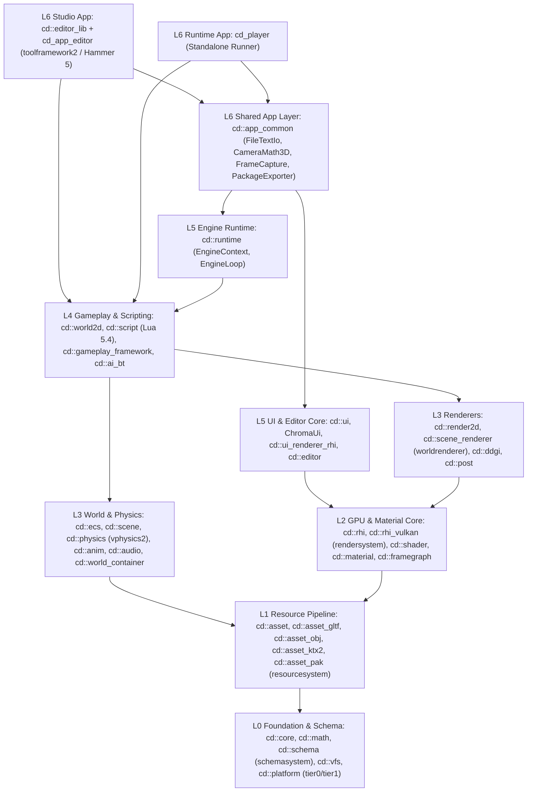

# CHROMODYNAMIC Architecture

This document defines the physical directory structure, strict layer Dependency Acyclic Graph (DAG), coordinate conventions, runtime frame flow, and Valve Source 2 subsystem mapping of **CHROMODYNAMIC**.

## 1. Architectural Principles

1. **Library-First Decomposition**: Every engine capability lives in an isolated CMake target (`cd::<name>`) with explicit `PUBLIC` and `PRIVATE` link boundaries. Any lower-level library (for example `cd::math`, `cd::schema`, `cd::vfs`, or `cd::render2d`) can be linked into standalone tools or tests without pulling in higher layers.
2. **Strict Downward DAG**: Headers in layer $L_k$ may only `#include` headers from layers $L_j$ where $j \le k$, with zero cycles inside the same tier. Automated verification (`check_layer_dag.py`) gates every wave.
3. **Thin Executables, Compiled Subsystems**: Entrypoints contain zero business logic. `apps/player/main.cpp` is **15 lines** and `apps/editor/main.cpp` is **23 lines**. Shared application utilities live in `cd::app_common`, and Studio subsystems compile in parallel inside `cd::editor_lib`.
4. **Single Canonical Owner**: Every cross-cutting responsibility (UTF-8 file I/O, 3D camera basis/ray/Euler math, swapchain PNG capture, `.cdpak` packaging, `.obj` parsing, 5x7 fallback pixel text) has exactly one canonical implementation in `engine/` or `cd::app_common`.

## 2. Strict Layer DAG & Valve Source 2 Mapping

| Rank | Tier | Representative Targets | Source 2 Equivalent | Allowed Dependencies |
| :-- | :-- | :-- | :-- | :-- |
| **L0** | Foundation & Schema | `cd::core`, `cd::math`, `cd::schema`, `cd::io`, `cd::vfs`, `cd::concurrency`, `cd::platform`, `cd::log`, `cd::diag` | `tier0`, `tier1`, `schemasystem` | C++23 standard library and OS primitives only |
| **L1** | Asset & Containers | `cd::asset`, `cd::asset_gltf`, `cd::asset_obj`, `cd::asset_ktx2`, `cd::asset_pak` | `resourcesystem` | L0 |
| **L2** | RHI, Shader & FrameGraph | `cd::rhi`, `cd::rhi_null`, `cd::rhi_vulkan`, `cd::shader`, `cd::material`, `cd::framegraph` | `rendersystem`, `materialsystem2` | L0, L1 |
| **L3** | World, Physics & Renderers | `cd::render2d`, `cd::scene_renderer`, `cd::ddgi`, `cd::post`, `cd::ecs`, `cd::scene`, `cd::physics`, `cd::anim`, `cd::audio`, `cd::world_container` | `worldrenderer`, `vphysics2`, `animationsystem`, `soundsystem` | L0, L1, L2 |
| **L4** | Script & Gameplay | `cd::script`, `cd::world2d`, `cd::element_core`, `cd::gameplay_framework`, `cd::ai_bt`, `cd::camera_rig`, `cd::trigger` | `server` / `client` domain logic | L0 through L3 |
| **L5** | UI & Runtime Loop | `cd::ui_layout`, `cd::ui_font`, `cd::ui_widgets` (`ChromaUi`), `cd::ui_renderer_rhi`, `cd::editor`, `cd::runtime` | `panorama` / `engine2` | L0 through L4 |
| **L6** | Applications | `cd::app_common`, `cd::editor_lib`, `cd_app_editor`, `cd_player` | `toolframework2` / **Hammer 5** | L0 through L5 |

## 3. Coordinate System, Units, and Projection Conventions

CHROMODYNAMIC enforces one consistent mathematical convention across math, physics, 3D rendering, audio, and Studio gizmos:

* **Handedness & Up Axis**: Right-handed world space with **+Y Up**, **+X Right**, and **-Z Forward** (matching glTF 2.0, Godot 4, and Jolt Physics).
* **Metric Units**: `1.0` world unit equals `1.0 meter` in 3D space; masses are in kilograms (`kg`), forces in Newtons (`N`), angles in radians internally and degrees (`Pitch X, Yaw Y, Roll Z` intrinsic `YXZ`) in Studio UI.
* **2D World Coordinates**: `Stage2D` uses metric world coordinates (`+Y Up` for platformer physics/jumping and camera follow) projected through subpixel-snapped `Camera2D` into top-left pixel screen space for `cd::ui::renderer::DrawBatcher`.
* **Clip Space & Depth**: Vulkan NDC (`x in [-1, 1]`, `y in [-1, 1]` top-to-bottom via projection sign flip, depth `z in [0, 1]`).
* **Color Space**: Scene lighting, Cook-Torrance BRDF evaluation, bloom, and volumetric fog operate in linear scene-referred HDR (`RGBA16F`), tone-mapped via AgX or ACES into `BGRA8` swapchain output.

## 4. Application & Studio Decomposition (`ADR-20261112`)

### 4.1 `cd::app_common` (`apps/common/`)

Eliminates all code duplication between `apps/editor` and `apps/player`:

* `FileTextIo.hpp/.cpp`: UTF-8 BOM-safe text file reading, atomic parent-directory file writing, and working-directory asset path resolution.
* `CameraMath3D.hpp/.cpp`: Orthonormal camera basis construction, NDC/pixel ray unprojection, Vulkan world-to-screen projection, `YXZ` quaternion/Euler conversion, grid snapping, and ray-sphere/ray-plane intersections.
* `FrameCapture.hpp/.cpp`: GPU swapchain staging readback (`BGRA8`/`RGBA8` to `RGBA8` PNG via `libpng`) and headless `DrawBatcher` software triangle/scissor rasterization for CI verification.
* `PackageExporter.hpp/.cpp`: Standalone game packaging into `.cdpak` archives paired with `cd_player.exe`, runtime DLLs, and a one-click launch script.

### 4.2 `cd::editor_lib` (`apps/editor/`)

Modeled after Valve Source 2 `toolframework2` and Hammer 5, `cd::editor_lib` compiles 14 focused translation units in parallel:

* `core/`: `StudioConfig` (early headless CLI `--dump-schema`, `--exec-2d-commands`, `--playtest-2d`, `--export-standalone`), `StudioState` (concrete `StudioEngineState` with zero file-static globals), and `StudioApp` (`on_boot`, `on_frame`, `on_shutdown`).
* `render/`: `WorldRenderPasses` (2048x2048 shadow map, clustered PBR + G-buffer + velocity, skinned glTF characters, Wronski volumetric fog, Karis bloom, AgX/ACES composite, TLAS ray-tracing sync, and DDGI probe volume updates).
* `scene/`: `SceneOperations` (clean empty/starter workspaces, 16 interactive templates, `.cdscene.json` save/load, undoable node/light spawn, duplicate, delete, focus, ground snap, and 250-construct catalog instantiation).
* `physics/`: `PhysicsPieSolver` (`enter_pie` / `exit_pie` with lossless JSON snapshot/restore, fixed-step rigid-body and character-controller ticking, 3D collider wireframes, and viewport drag-and-drop landing).
* `pipeline/`: `AssetIngest` (`cd::asset::obj::parse_obj` mesh loading, procedural/PNG texture upload, glTF folder scanning, and entity mesh/texture assignment).
* `workspace_2d/`: `Workspace2D` (dedicated 2D Viewport, Wang Auto-Tile brush, `cd::schema`-driven Inspector, live Lua 5.4 script editor, and `CommandBus2D` AI console).
* `ui/`: `UnifiedTopBar` (`32px` single bar), `ProjectHubModal`, `SceneTreeDock` (`Scene Outliner`), `InspectorDock` (`Inspector | World & Post-FX`), `ProjectAndToolsDock` (2-pane `Assets & FileSystem | Console | Construct Catalog | Profiler`), and `ViewportHudAndGizmo` (Hammer 5 viewport pill, 3D X/Y/Z orientation rose, transform gizmo, command palette).

## 5. Frame Execution Lifecycle

Each frame in `StudioApp` executes a deterministic sequence:

1. **OS & Hot-Reload Poll**: Pump platform window events into `ChromaUi` and poll on-disk GLSL shaders (`StudioShaderWatch`) every 64 frames.
2. **Simulation & PIE Step**: In Edit mode (when live physics is toggled) or Play-In-Editor (`F5`), step `cd::physics` / `Stage2D` and sandboxed Lua 5.4 `on_tick` callbacks.
3. **Transform & Acceleration Sync**: Update hierarchical `cd::scene` transforms, skinning joint matrices, and top-level ray-tracing acceleration structures (`TLAS`) when the scene hash changes.
4. **GPU Render Passes**: Record shadow depth, DDGI probe ray-trace/blend, HDR PBR + G-buffer + sky + debug grid, volumetric fog, bloom mip chain, tone-mapped composite, and single-pass `ChromaUi` vector/MSDF draw batches into the Vulkan command buffer.
5. **Optional Deterministic Readback**: When `--capture-png` is active, copy the rendered swapchain image into a host-visible staging buffer before presentation and write a verified PNG.
