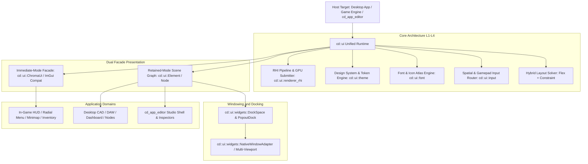
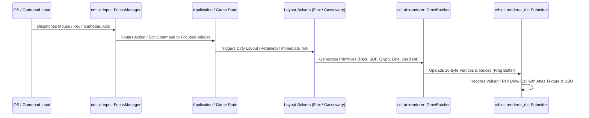

# cd::ui Unified Architecture — SOTA GPU/CPU Hybrid UI Specification

- **Status**: Approved UI/UX Architecture Specification
- **Version**: 1.0.0
- **Scope**: (1) Standalone Desktop Applications (CAD/DAW/Dashboard), (2) In-Game HUD/Spatial UI, (3) Engine Studio Editor (`cd_app_editor`)
- **Evidence Pointers**:
  - `engine/ui/layout/include/cd/ui/layout/Flex.hpp:1-120` (Yoga-semantic flexbox layout)
  - `engine/ui/layout/include/cd/ui/layout/Constraint.hpp:1-130` (Cassowary incremental constraint solver)
  - `engine/ui/widgets/include/cd/ui/widgets/DockSpace.hpp:100-220` (Multi-pane docking tree & splitters)
  - `engine/ui/widgets/include/cd/ui/widgets/ColorPicker.hpp:65-180` (OKLab/OKLCh perceptual picker)
  - `engine/ui/widgets/include/cd/ui/widgets/CurveEditor.hpp:55-210` (Hermite spline multi-curve overlay)
  - `engine/ui/theme/include/cd/ui/theme/Theme.hpp:50-160` (Design tokens & WCAG contrast)
  - `engine/ui/font/include/cd/ui/font/Font.hpp:1-75` (MSDF multi-channel & HarfBuzz shaping)
  - `engine/ui/renderer/include/cd/ui/renderer/DrawBatcher.hpp:1-60` (16-byte vertex draw batcher)
  - `engine/ui/renderer_rhi/include/cd/ui/renderer_rhi/Submitter.hpp:1-60` (RHI Vulkan/GPU pipeline submitter)
  - `engine/ui/input/include/cd/ui/input/Input.hpp:1-70` (Hit testing & focus management)
  - `engine/ui/widgets/include/cd/ui/widgets/EditorAndHudWidgets.hpp:1-90` (Editor and HUD widgets catalog)
  - `engine/ui/widgets/include/cd/ui/widgets/PopoutDock.hpp:1-60` & `NativeWindowAdapter.hpp:1-60` (Windowing)

---

## 1. Bileşen Hiyerarşisi (Component Hierarchy)



### 1.1 Katmanlı Mimari Detayı (Layered Architecture)
1. **L0 Foundation & Math**: `cd::math`, `cd::core` (`Result`, `std::expected`, generational handles).
2. **L1 Vector / Batcher Pipeline**: `DrawBatcher` (16-byte packed vertices: `pos2 + uv2 + rgba8 + variant_id`), scissor clipping stack, draw command merging.
3. **L2 Font / Icon Atlas**: MSDF Multi-channel (`kMsdfMulti`) rasterization via `msdfgen` + HarfBuzz Unicode/BiDi shaping + dynamic shelf bin-packing atlas texture.
4. **L3 Layout & Constraint Solvers**:
   - `Flex`: O(N) Yoga-semantic flexbox for flow-based responsive panels (`FlexDirection`, `JustifyContent`, `align-items`, `gap`, `flex-grow/shrink`).
   - `ConstraintSolver`: Cassowary incremental simplex solver (`VariableId`, `Strength`, edit variables) for complex CAD/DAW anchor topologies.
5. **L4 Input, Focus & Gamepad Navigation**:
   - 2D Spatial raycast/AABB projection navigation for D-pad/Left-stick.
   - Tab/Shift-Tab focus chain, modal capture stack, gesture recognizer.
6. **L5 Docking & Windowing**:
   - Binary tree `DockNode` (`kSplit`, `kTabGroup`, `kLeaf`), splitter drag, 5-zone docking drop overlay.
   - `PopoutDock` state machine + `NativeWindowAdapter` OS-window fallback pipeline.
7. **L6 Widget Catalogs & Tooling**:
   - Desktop & Studio Editor widgets.
   - In-game 2D & 3D Spatial HUD widgets.

---

## 2. Veri Akışı (Data Flow)



1. **Giriş İşleme**: OS event akışı (`OSEvent`) veya Gamepad/Spatial input, `cd::ui::input::FocusManager` ve `HitTester`'a beslenir.
2. **State & Mutation**: Widget state mutasyonu (retained tree veya immediate local variable) tetiklenir.
3. **Layout Geçişi**: Değişen düğümler dirty flag işaretlenir; `Flex` veya `ConstraintSolver` çalışarak piksel koordinatları `Rect` üretir.
4. **Komut Üretimi**: Widget'lar `DrawBatcher`'a çizim komutları (SDF rounded rect, drop shadow, glyph quads, gradient lines) yazar.
5. **GPU Gönderimi**: `Submitter`, vertex/index ring-buffer'ını upload eder, SDF font/icon atlas dokusunu ve tema UBO'sunu bağlayarak tek geçişte çizer.

---

## 3. UI State Modeli (Loading / Error / Success / Empty)

| State | Tanım & Görsel Temsil | Davranış & Etkileşim |
| :--- | :--- | :--- |
| **Loading** | Shimmer skeleton çizgileri, dönen `Spinner` (açı + hız), yarı saydam karartma (`0.5F alpha`). | Tüm etkileşimler geçici disable edilir; focus ring gizlenir; asenkron yükleme bitene kadar tıklama yutulur. |
| **Error** | Kırmızı vurgulu çerçeve (`PaletteSlot::kError`), `Icon::kWarning` badge'i, inline hata metni veya toast bildirim. | Form submit engellenir; ilgili input'a otomatik odaklanılır; kullanıcıya düzeltici eylem ("Retry" / "Reset") sunulur. |
| **Success** | Vurgu rengi (`PaletteSlot::kPrimary`), onay ikonu (`Icon::kCheck`), yeşil geçici bildirim balonu. | Veri kalıcı state'e commit edilir; dirty bayrağı temizlenir; animasyonlu geçişle normal görünüme dönülür. |
| **Empty** | Soluk sembolik illüstrasyon/ikon, açıklayıcı boş durum metni (örn: "Henüz eğri eklenmedi"), CTA butonu. | Kullanıcıyı çıkmaza sokmaz; merkezde "Yeni Ekle / İçe Aktar" birincil aksiyon butonu (`kPrimary`) yer alır. |

---

## 4. Bileşen Kataloğu (Widget Catalog Specifications)

### 4.1 Masaüstü & CAD/DAW Bileşenleri
- **DockSpace & Popout Window**: Sekmeli/bölmeli hiyerarşik yerleşim; paneller serbestçe ayrılıp harici ekrana taşınabilir (`NativeWindowAdapter`).
- **N-Column Table**: Sanallaştırılmış satır görünümü (100.000+ öğede 60 FPS), sütun genişletme/sıralama/filtreleme.
- **Hierarchical TreeView**: Proje hiyerarşisi, drag-drop taşıma desteği, inline yeniden adlandırma.
- **CurveEditor**: Catmull-Rom ve Hermite spline eğri kontrolü, in/out teğet tutamaçları (`KeyFrame`, `TangentMode`).
- **ColorPicker**: Perceptual OKLab/OKLCh renk uzayı, HSV halkası, RGB/Hex girişi, 8 yuvalı palet geçmişi.

### 4.2 Oyun-İçi (In-Game 2D & 3D Spatial) Bileşenleri
- **Radial Menu**: Gamepad sol çubuk açısıyla 360° dilim seçimi, haptic/hover titreşimi, yumuşak yay açılma animasyonu.
- **InventoryGrid**: N×M yuvalı envanter matrisi, öğe yığın sayıları, sürükle-bırak hayalet rozetleri (`GhostPayload`).
- **Minimap / Radar**: Oyuncu merkezi, yön rotasyonu, dinamik nesne pinleri (düşman, görev, dost).
- **GaugeBar / HealthBar**: Çift katmanlı gecikmeli hasar animasyonu (kırmızı anlık düşüş + sarı gecikmeli takip).
- **DialogueBox**: Daktilo metin akışı efekti, portre penceresi, dallanan seçenek butonları, gamepad A/B hızlı ilerletme.
- **WorldSpaceUI (Spatial 3D)**: Kamera matrisi ile 3D uzayda billboarding veya yüzeye yansıtılan UI panelleri.

### 4.3 Motor Editörü (`cd_app_editor`) Bileşenleri
- **NumericDragBox & Vec3Control**: X(Kırmızı)/Y(Yeşil)/Z(Mavi) eksen kaydırıcıları, çift tıkla sayısal düzenleme, varsayılana sıfırlama.
- **NodeGraphCanvas**: Sınırsız pan/zoom ızgara tuvali, düğüm soketleri, Bézier bağlantı telleri.
- **FlameChart / Profiler**: CPU/GPU zaman çizelgesi blokları, mikro-saniye zoom/pan, çağrı yığını hiyerarşisi.
- **AssetPicker & Inspector DropZone**: Varlık meta verilerini sürükleyip bırakma hedefi.

---

## 5. UI Developer Kontratı (C++23 API & Types)

```cpp
namespace cd::ui
{

/// Unified Widget ID
struct WidgetId
{
    std::uint32_t value { 0xFFFFFFFFu };
    [[nodiscard]] constexpr bool is_valid() const noexcept { return value != 0xFFFFFFFFu; }
};

/// 4-State UI Presentation
enum class WidgetVisualState : std::uint8_t
{
    kEmpty   = 0,
    kLoading = 1,
    kSuccess = 2,
    kError   = 3
};

/// Navigation direction for Gamepad / Keyboard Spatial Navigation
enum class NavDirection : std::uint8_t
{
    kUp = 0,
    kDown,
    kLeft,
    kRight
};

/// Unified UI Context facade
class IUiContext
{
public:
    virtual ~IUiContext() = default;

    // Theme & Styling
    [[nodiscard]] virtual const theme::Theme& theme() const noexcept = 0;
    virtual void set_theme(const theme::Theme& t) noexcept = 0;

    // Font & Atlas
    [[nodiscard]] virtual font::Font* font() noexcept = 0;

    // Input & Focus
    [[nodiscard]] virtual input::FocusManager& focus_manager() noexcept = 0;
    virtual void navigate(NavDirection dir) noexcept = 0;

    // Frame Execution
    virtual void begin_frame(float delta_time, float screen_w, float screen_h) = 0;
    virtual void end_frame() = 0;
    virtual void render(renderer_rhi::Submitter& submitter) = 0;
};

} // namespace cd::ui
```

---

## 6. Edge Cases & Çözüm Stratejileri

1. **Multi-DPI Monitör Geçişleri**: Pencere farklı DPI ölçeğine sahip monitöre sürüklendiğinde, `Theme::Spacing` ve `Typography::size_pt` anında yeni DPI faktörüyle ölçeklenir; MSDF font atlası bulanıklaşmadan keskin kalır.
2. **Aşırı Küçük Pencere / Taşma (Overflow)**: Minimum panel boyutları (`min_w`, `min_h`) splitter tarafından zorlanır; içerik taşarsa `ScrollArea` scissor clipping ile güvenli bir şekilde kaydırılabilir hale gelir.
3. **Cassowary / Flex Sonsuz Döngü Koruması**: Çakışan kısıtlamalarda `add_constraint` aşamasında infeasibility tespit edilip `std::unexpected` döner; fallback olarak Flexbox akışına geçilir.
4. **Eksik Font Glifi (Missing Glyph)**: Unicode glifi font atlasında yoksa, sistem çökmez; evrensel yedek glif (`U+FFFD` ) veya kutu (`[]`) çizilir.
5. **Gamepad Bağlantı Kopması**: Aktif gamepad menüsündeyken cihaz bağlantısı kesilirse, modal durumu kilitlenmez; klavye/fare odak kontrolü otomatik devreye girer.
