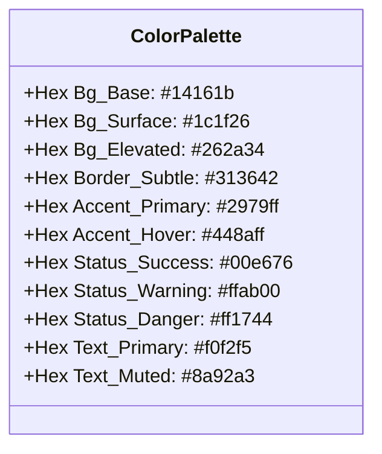

# CHROMODYNAMIC Studio — SOTA UI/UX Master Benchmark & Unified Architecture
*(Godot 4.3 • Unreal Engine 5.4 • Blender 4.2 • Hazel Engine • Valve Source 2 / Hammer 5 • Unity 6 • Remedy Northlight)*

- **Doküman Kodu**: `DOC-CD-STUDIO-UX-UI-MASTER-20261018`
- **Durum**: Onaylanmış UI/UX Mimari ve Tasarım Spesifikasyonu (Approved Master Spec)
- **Kapsam**: `CHROMODYNAMIC Domestic 3D Engine Studio` (`apps/editor`), `cd::ui` bileşen mimarisi ve editör iş akışları
- **Hedef**: Zamansız (Timeless), sıfır dikkat dağınıklığı sunan, endüstri standardı 7 motorun en güçlü taraflarını tek potada eriten domestik stüdyo editör ergonomisi

---

## 1. Yönetici Özeti & Mimari Kuzey Yıldızı (Executive Summary)

Modern oyun motoru editörleri iki aşırı uç arasında sıkışmıştır:
1. **Gereksiz Karmaşık / Yığılmış Arayüzler (Cluttered DCCs / Legacy Engines)**: Ekranda yüzlerce küçük, tutarsız renkli butonun, derin gizlenmiş pencerelerin ve görsel hiyerarşisi olmayan metin yığınlarının bulunduğu, geliştiricinin bilişsel yükünü (cognitive load) tüketen yapılar.
2. **Aşırı Basitleştirilmiş / İşlevsiz Oyuncaklar**: Yalnızca temel birkaç kaydırıcı sunan, derin oyun mantığı, gölgelendirme boru hatları ve karmaşık fizik kurgularında yetersiz kalan arayüzler.

**CHROMODYNAMIC Studio**'nun mimari hedefi, **"Zamansız Tasarım (Timeless UX)"** ilkesidir:
- **Kaynak 1 (Valve Source 2 / Hammer 5 & S&box)**: Anında CSG / Blockout hızı, dikey araç rafı, 3D Viewport içi yarı-saydam görünüm hapları, sağ-üst 3D yönelim gülü ve varlık-odaklı alt çekmece.
- **Kaynak 2 (Unreal Engine 5.4)**: Ortalanmış simetrik Transport (Play/Simulate/Step) paneli, `[+ Create]` hızlı ekleme merkezi, 2 sütunlu Details (Inspector) yerleşimi.
- **Kaynak 3 (Godot 4.3)**: Tam boy dikey Sahne Ağacı (`Scene Outliner`), anlık arama/filtreleme, satır-içi göz (Görünürlük) ve asma kilit (Seçim Kilidi) butonları, sıfır isim kirliliği.
- **Kaynak 4 (Blender 4.2)**: 3D Viewport üstü yarı-saydam overlay kontrolleri, interaktif X/Y/Z navigasyon eksen gülü, en alttaki bağlamsal durum çubuğu (Status Bar) ve X/Y/Z renk şeritli (Kırmızı/Yeşil/Mavi) sayısal sürükleme kutuları.
- **Kaynak 5 (Hazel Engine - The Cherno)**: Minimalist yüksek kontrastlı karbon/arduvaz tema (`#17191f`, `#20242c`), sıfır gökkuşağı buton kirliliği, tertemiz dörtlü temel yerleşim (Outliner + Viewport + Properties + Content Browser).
- **Kaynak 6 & 7 (Unity 6 & Remedy Northlight)**: Prefab/Variant kompozisyon netliği, canlı PIE oyun içi durum geri bildirimi ve modüler bileşen/kapsül yığını (Capsule Stack).

```mermaid
graph TD
    subgraph 7 SOTA Reference Engines
        S2[Valve Source 2 / Hammer 5<br/>Tool Shelf • Viewport Pills • NavGizmo]
        UE[Unreal Engine 5.4<br/>Centered Transport • [+ Create] • 2-Col Details]
        GD[Godot 4.3<br/>Full-Height Outliner • Clean Row • Eye/Lock]
        BL[Blender 4.2<br/>Translucent Overlays • Axis Colors • Status Bar]
        HZ[Hazel Engine<br/>Slate Theme • Zero Rainbow • Minimalist Quad]
        UN[Unity 6 & Remedy Northlight<br/>Prefab Flow • PIE Feedback • Capsule Stack]
    end

    subgraph CHROMODYNAMIC Studio Unified Architecture
        CD_Top[Bölge 1: Üst Bar & Ortalanmış Transport UE5+Blender]
        CD_Left[Bölge 2: Tam Boy Sekmeli Sol Panel Godot4+Source2]
        CD_Center[Bölge 3: 3D Viewport & Overlays S2+Blender4]
        CD_Right[Bölge 4: 2 Sütunlu Details & Kapsül Yığını UE5+Northlight]
        CD_Bottom[Bölge 5: Alt Çekmece & 250 Construct Kartı UE5+Hazel]
        CD_Footer[Bölge 6: Bağlamsal Durum Çubuğu Blender4]
    end

    S2 --> CD_Left
    S2 --> CD_Center
    S2 --> CD_Bottom
    UE --> CD_Top
    UE --> CD_Right
    UE --> CD_Bottom
    GD --> CD_Left
    BL --> CD_Center
    BL --> CD_Right
    BL --> CD_Footer
    HZ --> CD_Left
    HZ --> CD_Right
    UN --> CD_Right
    UN --> CD_Top
```

---

## 2. Kapsamlı Karşılaştırmalı Analiz: 7 SOTA Editör Benchmark Tablosu

Aşağıdaki matris, modern oyun motoru ve 3D içerik üretim araçlarının kritik UI/UX bileşenlerini karşılaştırmakta ve CHROMODYNAMIC Studio'nun sentez yaklaşımını tanımlamaktadır:

| Özellik / Boyut | Valve Source 2 (Hammer 5) | Unreal Engine 5.4 | Godot 4.3 | Blender 4.2 | Hazel Engine | Unity 6 / Northlight | CHROMODYNAMIC Studio (Yeni Tasarım) |
| :--- | :--- | :--- | :--- | :--- | :--- | :--- | :--- |
| **Temel Arayüz Teması** | Koyu endüstriyel gri, fonksiyonel | Koyu arduvaz (`Slate`), düz, minimalist | Koyu mavi-gri, kompakt, yüksek yoğunluklu | Koyu grafit (`Graphite`), yüksek kontrast | Karbon siyahı, sıfır süs, ultra sade | Gri/Gümüş koyu mod, teknik | **Chroma Slate/Carbon Dark (WCAG AAA uyumlu)** |
| **Ana Araç Çubuğu / Transport** | Sol dikey araç rafı | Üstte ortalanmış simetrik [>][||][#] çubuğu | Üst-sağda küçük [>][||][#] butonları | Üst ortada playback timeline kontrolleri | Üst ortada minimal Play/Simulate/Stop | Üst ortada belirgin Play/Pause/Step | **Üst Ortalanmış Transport (UE5) + Dikey Hızlı Araç Rafı (Source 2)** |
| **Sol Panel / Hiyerarşi (Outliner)** | Sol dikey araç rafı + Ağaç görünümü | Sağ üst köşede Outliner (varsayılan) | **Tam boy sol panel**, dikey alanın %100'ü | Sağ üstte Outliner (koleksiyon bazlı) | Sol panelde tekil Scene Hierarchy | Sol panelde Hierarchy | **Tam Boy Sol Panel: `Outliner` / `Place & Toolbox` / `Worlds` sekmeli (Godot + Source 2)** |
| **Hiyerarşi Satır Tasarımı** | İkon + İsim + Varlık tipi | İsim + Tip + Göz (Görünürlük) | **Çentik + Tip İkonu + İsim + Göz/Kilit** | Koleksiyon rengi + Tip + Göz/Kamera/Filtre | Tip İkonu + İsim + Sağ menü | İsim + Mavi Prefab çubuğu + Göz | **Godot Satır Düzeni: Sol Tip İkonu + İsim, Sağa Yaslı [Göz][Kilit] ve Temiz 16px Rozetler** |
| **3D Viewport Başlığı & Overlays** | **Sol-üst görünüm hapları** (`Lit`, `2D Wire`) | Sol-üst açılır menüler (`Lit`, `Perspective`) | Sol-üst küçük şerit menüler | **Yarı-saydam haplar** (`Shading`, `Overlays`) | Minimalist viewport araç çubuğu | Sol-üst araç şeridi + gizmo butonları | **Yarı-saydam Sol-Üst Haplar (`Lit`, `Cam`, `Snap`) + Sağ-Üst 3D NavGizmo (Source 2 + Blender)** |
| **3D Eksen Gülü (Orientation)** | Sağ-üst 3D Eksen Küpü (Tıklanabilir) | Sağ-üst yönelim oku (statik) | Sağ-üst interaktif eksen gülü | **Sağ-üst X/Y/Z renkli interaktif NavGizmo** | Viewport içi mini yön göstergesi | Sağ-üst Scene Gizmo küpü | **Sağ-Üst İnteraktif X/Y/Z Eksen Gülü (Tıklamayla Top/Front/Side/Iso ortografik kilidi)** |
| **Inspector (Details / Properties)** | Sağ panel, sekmeli özellikler | **2 sütunlu Details**, arama + reset sarı oku | Sağ panel, kategorize katlanabilirler | Sağ alt panel, ikonlu dikey sekmeler | Sağ panel, modüler bileşen kartları | Sağ panel, bileşen yığını | **2 Sütunlu Details + Modüler Kapsül Yığını (UE5 + Northlight + Hazel)** |
| **Sayısal Giriş Kutuları** | Klasik kutu, çift tıklama | Sürükle-bırak sayısal alanlar | Mavi sürükleme dolgulu kutular | **X: Kırmızı, Y: Yeşil, Z: Mavi sol şeritli** | Sade metin/sayı alanları | Gri etiketli sürükleme alanları | **Blender 4.2 Stili: X (Kırmızı), Y (Yeşil), Z (Mavi) renk şeritli sürükleme kutuları** |
| **Varlık Tarayıcısı (Browser)** | Varlık Odaklı Seçici / Alt Çekmece | **Content Drawer (`Ctrl+Space`)** | Alt panel FileSystem | Dosya tarayıcısı alanı | Alt panel Content Browser | Alt panel Project sekmesi | **Katlanabilir / Dock Edilebilir Content Drawer + 250 Construct Kartı (UE5 + Source 2)** |
| **Durum Çubuğu (Status Bar)** | Izgara boyutu, koordinatlar | Derleme durumu, bildirimler | Hata/Uyarı konsol özeti | **Bağlamsal fare kısayolları, bellek/VRAM** | Basit log alanı | Alt durum çubuğu | **Blender Stili: Bağlamsal Kısayol Rehberi (LMB/RMB/Space/G/F) + Canlı GPU Telemetrisi** |

---

## 3. 7 Referans Motorun Derinlemesine Analizi (Deep Dive)

### 3.1 Valve Source & Source 2 (Hammer 5 / S&box)
- **Zamansız Araç Rafı (Tool Shelf)**: Hammer 5'in en büyük ergonomik üstünlüğü, ekranın sol kenarına dikey olarak yerleştirilmiş `Selection (Shift+S)`, `CSG Blockout (Shift+B)`, `Clipping (Shift+X)` ve `Physics/Deform` araç çubuğudur. Bu araçlar kullanıcıyı menülerde arama yapmaktan kurtarır ve seviye tasarımcısına "sıfır gecikmeli" geometri bloklama imkanı tanır.
- **CSG / Blockout Hızı**: Fırça (Brush) veya hacimsel ızgara tabanlı bloklama, prototip aşamasında sahnenin saniyeler içinde oynanabilir hale gelmesini sağlar.
- **3D Viewport İçi Görünüm Hapları**: Hammer 5, ekranın sol-üst köşesine yarı-saydam butonlar yerleştirir: `[Camera: 3D Perspective]`, `[View: Textured/Lit]`, `[Colliders: On/Off]`. Bu yapı, ana menü çubuklarını işgal etmeden kameraya ait modları doğrudan sahne üzerinden değiştirmeyi sağlar.
- **Sağ-Üst 3D Eksen Gülü**: 3D eksen yönelimi yalnızca bir görselleştirme değil, tıklanabilir bir manipülatördür. `+X`, `+Y` veya `+Z` kürelerine tıklandığında kamera anında ortografik görünüme kilitlenir.
- **Varlık-Odaklı (Asset-First) Seçici**: Dokuların, materyallerin ve modellerin doğrudan geometri yüzeyine sürüklenip bırakılması ve anında uygulanması.

### 3.2 Unreal Engine 5.4
- **Ortalanmış Simetrik Transport Çubuğu**: Editörün en üst merkezinde yer alan `[Play (F5)]`, `[Simulate]`, `[Step (Single Frame)]` ve `[Stop (F8)]` butonları, kullanıcının göz hizasında ve tek odak noktasındadır. Sol ve sağındaki araçlar simetrik dengelenmiştir.
- **`[+ Create]` Hızlı Ekleme Menüsü**: Araç çubuğunun solunda tek bir buton (`+`) üzerinden tüm temel primitifler, ışıklar (Point, Spot, Directional, Rect), sinematik kameralar, görsel efektler ve blueprint aktörleri kategorize olarak eklenebilir.
- **Görsel Kartlı Content Drawer (`Ctrl+Space`)**: Ekranı sürekli işgal eden bir alt panel yerine, `Ctrl+Space` kısayolu ile alttan yukarı yumuşakça kayan ve iş bittiğinde otomatik kapanan (veya iğnelenebilen) çekmece mimarisi, 3D Viewport alanını maksimize eder.
- **2 Sütunlu Details Paneli**: Sol sütunda alan adı (%40), sağ sütunda düzenleme widget'ı (%60). Değeri varsayılana döndürmek için sağda sarı ok düğmesi (`Reset to Default`) ve üstte anlık arama/filtreleme çubuğu.

### 3.3 Godot 4.3
- **Tam Boy Sol Sahne Ağacı (`Scene Outliner`)**: Godot, hiyerarşiyi dikey ekran yüksekliğinin tamamına yayarak karmaşık sahne ağaçlarında kaydırma ihtiyacını en aza indirir.
- **Hızlı `+ Add Child Node` (`Ctrl+A`)**: Seçili düğüme anında çocuk ekleme diyaloğu, tip filtresi ve son kullanılanlar listesiyle yıldırım hızında çalışır.
- **Temiz Hiyerarşi Satırı Tasarımı**:
  - Sol tarafta hiyerarşik girinti (çentik çizgileri) ve düğüm tip ikonu (2B için mavi, 3B için kırmızı, UI için yeşil).
  - Ortada yalnızca varlığın adı.
  - Sağa yaslanmış: Göz ikonu (görünürlük aç/kapat) ve Asma Kilit ikonu (seçim kilidi aç/kapat).
  - Sıfır gereksiz metin etiketi: Bilişsel gürültü tamamen engellenmiştir.

### 3.4 Blender 4.2
- **3D Viewport Yarı-Saydam Overlay Kontrolleri**: Viewport'un sağ-üst ve sol-üst köşelerine yerleştirilmiş yüzen yarı-saydam butonlar (`Viewport Overlays`, `Shading Modes`, `Wireframe Density`). Bu kontroller sahnenin render tamponunun üzerine biner, ayrı bir pencere veya şerit alanı işgal etmez.
- **Sağ-Üst X/Y/Z İnteraktif Navigasyon Gizmosu**: Blender'ın ikonik küre eksen gülü. X (kırmızı), Y (yeşil), Z (mavi) eksen uçlarına tıklandığında perspektif/ortografik geçişi pürüzsüz kamera enterpolasyonu ile gerçekleşir. Boş alanda sürüklendiğinde yörünge (orbit) kamerası döner.
- **En Altta Bağlamsal Durum Çubuğu (Status Bar)**: O an aktif olan araca veya fare imlecinin altındaki öğeye göre geçerli tuş kombinasyonlarını listeler: `LMB: Select | MMB: Orbit | Shift+MMB: Pan | RMB: Context Menu`. Sağ tarafta ise sahne poligon sayısı (`Tris`), bellek tüketimi (`RAM / VRAM`) ve motor sürüm bilgisi yer alır.
- **X/Y/Z Renk Şeritli Sayısal Sürükleme Kutuları**: Transform alanlarında metin olarak "X:", "Y:", "Z:" yazmak yerine kutunun sol kenarına kırmızı, yeşil ve mavi dikey renk şeridi eklenmesi, beynin eksenleri anında tanımasını sağlar ve yatay alandan tasarruf ettirir.

### 3.5 Hazel Engine (The Cherno)
- **Minimalist Karbon/Arduvaz Tema**: Hazel, editör arayüzünde dikkati sahneden çalacak hiçbir parlak renge izin vermez. Paneller koyu gri (`#181a20`), aktif öğeler arduvaz mavisi (`#32527b`), metinler açık gridir.
- **Sıfır Gökkuşağı Buton Kirliliği**: Butonlar kırmızı, yeşil, mavi, sarı gibi rastgele renklerle boyanmaz. Tek bir birincil aksiyon rengi vardır. Renk yalnızca hata (kırmızı) veya başarı/aktif durum (yeşil/mavi) bildiriminde kullanılır.
- **Klasik Dörtlü Yerleşim**: Scene Hierarchy (Sol), 3D Viewport (Merkez), Properties / Inspector (Sağ), Content Browser / Console (Alt). Bu yerleşim geliştiricinin kas hafızasını korur.

### 3.6 Unity 6 & Remedy Northlight
- **Unity 6 Prefab / Variant Akışı**: Bir varlığın orijinal şablonundan ayrışan özellikleri sağ kenardaki ince mavi çizgi ile belirtilir; tek tıkla şablona geri dönülebilir (`Revert`) veya uygulanabilir (`Apply All`).
- **Remedy Northlight Kapsül Yığını (Capsule Stack)**: Northlight motorunda oyun nesneleri devasa C++ sınıfları yerine hafif "Kapsüller" (`Capsules`) ve bileşenler yığınından oluşur. Her kapsül bağımsız bir katlanabilir karttır, sürüklenerek sırası değiştirilebilir, tek tıkla devre dışı bırakılabilir ve canlı PIE esnasında görsel sağlık/çakışma durumunu renkli durum noktalarıyla gösterir.

---

## 4. Mevcut Ham CHROMODYNAMIC Studio UI Analizi & UX Kusurları

Yapılan kod denetimi (`apps/editor/StudioWorkspacePanels.hpp`, `StudioPhysicsSolver.hpp`, `StudioToolbar.hpp`) sonucunda tespit edilen 4 kritik UX kusuru ve çözümleri aşağıda detaylandırılmıştır:

```
[MEVCUT HAM DURUM - UX KUSURLARI]
+----------------------------------------------------------------------------------------------------+
| MainMenuBar: File | Edit | Create 3D | Create Light | Camera | View | UI | Projects | [PLAY] [Theme] |
+----------------------------------------------------------------------------------------------------+
| Ribbon Toolbar (32px): [3D Studio][HUD][Lab] | [Move][Rot][Scale] | [Snap][Floor] | [Phys ON]...   |
+------------------------------------+---------------------------------------+-----------------------+
| SOL PANEL: Studio Workbench        | MERKEZ: 3D Viewport                   | SAĞ: Inspector        |
| - Quick Playgrounds (6 renkli btn) | (32px şerit altında sabit,             | - Transform           |
| - 18 Spawn Card (2-sütun buton)    |  Viewport içinde hap menü YOK,        | - Modifier Stack      |
| - 15 Modifier Card (2-sütun buton) |  Sağ-üstte NavGizmo YOK,              |                       |
|   TOPLAM 38 SIKIŞIK GÖKKUŞAĞI      |  Etiketler pencere arkasına taşıyor)  |                       |
|   BUTON! METİNLER SIĞMIYOR.        |                                       |                       |
+------------------------------------+                                       |                       |
| SOL ALT: Scene Outliner            |                                       |                       |
| - [V][L][LOCKED][Characters][RB]   |                                       |                       |
|   [BoxCol][CapCol] Player_Hero     |                                       |                       |
|   METİN YIĞILMASI / OKUNAMIYOR!    |                                       |                       |
+------------------------------------+---------------------------------------+-----------------------+
| ALT PANEL: 250-Construct Catalog                                                                   |
| [Kategori Filtreleri (6 btn)] [Arama] | Sol Liste | Sağ Detay Kartı                                |
| Butonlar kartın EN ALTINDA: [+ Spawn Root Element/Vessel] [+ Nest...] [+ Fold...]                  |
| SABİT PİKSEL GENİŞLİĞİ NEDENİYLE METİNLER KIRPILIYOR, KULLANICI AŞAĞI KAYDIRMAK ZORUNDA!           |
+----------------------------------------------------------------------------------------------------+
```

### Kusur 1: Sol Paneldeki 38 Sıkışık Gökkuşağı Buton Yığını
- **Bulunduğu Konum**: `StudioWorkspacePanels.hpp:600-775` (`draw_clean_studio_workspace_panels`, Section A, B, C).
- **Kök Neden**: 6 sahne şablonu butonu, 18 3D nesne oluşturma butonu ve 15 modifikatör atama butonu (toplam 39 adet) tek bir sol dock penceresinde 2 sütunlu tablolar halinde alt alta yığılmıştır. Butonlar koyu yeşil, mavi, mor, turuncu, kahverengi gibi 8 farklı renkle boyanmış ("gökkuşağı etkisi"), 17px/19.5px gibi aşırı basık yüksekliklerle sıkıştırılmıştır.
- **Kullanıcıya Etkisi**: Dikey alanda yoğun kaydırma gerektirir, görsel dikkat dağınıklığı ve yorgunluk yaratır, profesyonel bir DCC veya motor stüdyosu hissini zedeler.
- **SOTA Çözüm**:
  - Sol panel **tam boy** dikey alana yayılır.
  - 3 ayrı sekmeli yapıya (`TabBar`) dönüştürülür:
    1. `Scene Outliner`: Godot stili tam boy sahne hiyerarşisi.
    2. `Place & Toolbox`: Source 2 / UE5 tarzı temiz kategorize araç rafı ve arama filtreli nesne kataloğu.
    3. `Worlds & Stages`: Proje, çoklu dünya, seviye ve katman yöneticisi.
  - Gökkuşağı renkleri tamamen kaldırılarak Hazel / Unreal Slate koyu karbon paleti uygulanır; aktif/hover durumları tek tip nötr-mavi aksanla vurgulanır.

### Kusur 2: Hiyerarşi Satırlarındaki Metin Kirliliği (`[Characters][RB][BoxCol][CC]`)
- **Bulunduğu Konum**: `StudioWorkspacePanels.hpp:880-925`.
- **Kök Neden**: Her entity satırında string birleştirme (`badges += "[RB]"`, `badges += "[BoxCol]"`, `badges += "[Characters]"`) yapılarak tüm etiketler doğrudan nesne adı metninin sonuna eklenmektedir:
  `[V][L][LOCKED][Characters][RB][BoxCol][CapCol] Player_Hero_CesiumMan`.
- **Kullanıcıya Etkisi**: Satır uzunluğu pencere genişliğini aşmakta, yatay kaydırma çubuğu çıkmakta, nesnenin asıl adı okunamaz hale gelmekte ve ağaç girintisi anlamsızlaşmaktadır.
- **SOTA Çözüm**:
  - Satır formatı Godot 4.3 + Blender 4.2 standardına getirilir:
    `[Çentik + Derinlik Çizgisi] [Tip İkonu] [Varlık Adı]`
  - Görünürlük (`Eye`) ve Seçim Kilidi (`Lock`) butonları satırın sağ tarafına hizalanır.
  - Kapsül ve modifikatör göstergeleri, satırın en sağına yerleştirilen mikro 16×16px temiz rozetlere (`[RB]`, `[COL]`, `[VOL]`) dönüştürülür. Rozetin üzerine gelindiğinde (`Hover`) zengin tooltip açılır; satır metnine asla string eklenmez.

### Kusur 3: 3D Viewport HUD Kirliliği ve Eksik Navigasyon Kontrolleri
- **Bulunduğu Konum**: `StudioPhysicsSolver.hpp:1087-1230` (`##studio_viewport_hud`).
- **Kök Neden**: 32px yüksekliğindeki opak gri bir şerit panel ekranın solundan sağına uzanmakta, MainMenuBar ile Viewport arasına sıkışmaktadır. Viewport'un kendi içinde doğrudan kamera görünümü, gölgelendirme modu ve koordinat yönelim gizmosu bulunmamaktadır.
- **Kullanıcıya Etkisi**: 3D sahne dikey alanda daralmakta; kamera veya ışık modunu değiştirmek için kullanıcı yukarıdaki menülere gitmek zorunda kalmaktadır. Ayrıca kullanıcının 3D uzayda hangi yöne baktığını gösteren ve eksen kilitleyen bir interaktif yön göstergesi yoktur.
- **SOTA Çözüm**:
  - 32px opak şerit kaldırılır.
  - **Sol-Üst Yüzen Yarı-Saydam Haplar (Source 2 / Blender stili)**:
    - `[ Lit PBR v ]` (Lit, Normals, Albedo, Roughness, Depth, Colliders).
    - `[ Perspective v ]` (Persp, Top, Front, Right, Iso).
    - `[ Overlays v ]` (Grid, Gizmo, Wires, Sensor Radii, Contact Points).
  - **Sağ-Üst 3D Eksen Gülü (Blender 4.2 NavGizmo)**:
    - Kırmızı (+X/-X), Yeşil (+Y/-Y), Mavi (+Z/-Z) interaktif yönelim küresi.
    - Küreye tıklandığında anında ortografik görünüme yumuşak geçiş; sürüklendiğinde yörünge dönüşü.

### Kusur 4: Alt Paneldeki 250-Construct Kartında Buton Kırpılması ve Konumlandırma Hatası
- **Bulunduğu Konum**: `StudioWorkspacePanels.hpp:392-420`.
- **Kök Neden**: `[+ Spawn Root Element/Vessel]`, `[+ Nest as Child Element]`, `[+ Fold as Inline Capsule]` aksiyon butonları kartın en altına konulmuş ve `162px`, `148px`, `152px` gibi sabit piksel genişlikleri verilmiştir.
- **Kullanıcıya Etkisi**: Panel genişliği daraldığında butonlar birbirinin üstüne binmekte veya metinleri kesilmektedir (`[+ Spawn Root El...]`). Ayrıca kullanıcı her bir yapı taşını sahneye eklemek için kartın alt kısmına kadar kaydırma yapmak zorundadır.
- **SOTA Çözüm**:
  - 3 Kompozisyon butonu, detay kartının **en üstüne sabitlenmiş aksiyon çubuğuna (Pinned Header Toolbar)** taşınır.
  - Butonlar sabit genişlik yerine esnek layout (`ImVec2(-1.0F, ...)` veya eşit sütunlu tablo) ile yerleştirilir.
  - Buton etiketleri netleştirilir:
    `[+ Spawn Root]` • `[+ Nest Child]` • `[+ Fold Capsule]`
  - Kartın alt kısmı ise zengin dokümantasyon, SOTA yükseltmesi ve Godot denkliği için tam boy kaydırılabilir alana (`BeginChild`) dönüştürülür.

---

## 5. CHROMODYNAMIC Studio Birleşik (Unified) UI/UX Mimarisi & Yerleşim Tasarımı

### 5.1 Genel Editör Düzeni & Tel Çerçeve (Editor Wireframe)

```
+--------------------------------------------------------------------------------------------------------------------+
| [cd::icon] CHROMODYNAMIC STUDIO   File  Edit  Create  Lighting  Tools  Window  Help   | [> PLAY] [||] [Step] [Stop]  | 60 FPS (16.6ms) |
+------------------------+-------------------------------------------------------------------+-----------------------+
| OUTLINER | PLACE | WLD |  [ Lit PBR v ] [ Persp v ] [ Overlays v ] [ Snap: 0.5m v ]         | DETAILS (INSPECTOR)   |
|------------------------|                                                [ (X)(Y)(Z) Gizmo ]|-----------------------|
| [Q Filter nodes...] [+]|                                                                   | > Transform3D         |
| v Stage_Root           |                                                                   |   Pos  [X 0.0][Y 1.5] |
|   > Sun_Light [DIR]    |                                                                   |   Rot  [X 0.0][Y 0.0] |
|   v Avatar_Hero        |                       3D VIEWPORT                                 |   Scale[X 1.0][Y 1.0] |
|     Mesh_CesiumMan     |                 (Vulkan 1.3 Clustered PBR                         |-----------------------|
|     [CAP] CharacterCtl |                  + Donanım D32_FLOAT Depth                        | v AvatarVessel3D      |
|     [CAP] CapsuleCol3D |                  + CSM Shadows + IBL + DDGI)                      |   Mass (kg)   [ 75.0] |
|   > Crate_Physics [RB] |                                                                   |   Friction    [ 0.45] |
|   > Trigger_Beacon[TRG]|                                                                   |-----------------------|
|                        |                                                                   | + Add Capsule / Mod   |
+------------------------+-------------------------------------------------------------------+-----------------------+
| [^] CONTENT DRAWER (Ctrl+Space) / 250 UNIVERSAL CONSTRUCT CATALOG                                                  |
| Filter: [All (250)] [Core (21)] [2D (50)] [3D (88)] [UI (60)] [SOTA (31)]  | Search: [Search constructs...]        |
|---------------------------------------------+----------------------------------------------------------------------|
| [#117 | VSL] CharacterBody3D <-> Avatar3D   | [+ Spawn Root]  [+ Nest Child]  [+ Fold Capsule]  [Docs / API Guide] |
| [#121 | VSL] VehicleBody3D <-> Rover3D      | Semantic: AvatarVessel3D (#117) | Category: Node3D | Godot: 23:14    |
| [#220 | STG] DdgiIrradianceVolume3D [SOTA]  | Bundled:  Transform3D + CharacterControllerCapsule + CapsuleCollider3D |
| [#221 | CAP] TurquinMultiScatterPBR [SOTA]  | Tech:     Dual-lobe GGX multi-scattering with energy conservation    |
+---------------------------------------------+----------------------------------------------------------------------|
| [Status] Ready | LMB: Select | MMB: Orbit View | RMB: FreeLook | Space: Gizmo Mode | G: Snap Floor | VRAM: 1.1GB/8.0GB      |
+--------------------------------------------------------------------------------------------------------------------+
```

### 5.2 Bölge 1: Üst Bar & Ortalanmış Transport (UE5 + Blender Stili)
- **Sol Taraf**: Motor logosu, Proje Adı (`CHROMODYNAMIC STUDIO — SponzaAtrium.cdproj`), Klasik Menü Ağacı (`File`, `Edit`, `Create`, `Lighting`, `View`, `Tools`, `Window`, `Help`).
- **Merkez Taraf**: **Ortalanmış Simetrik Transport Paneli**:
  - `[ > PLAY (F5) ]`: Canlı oyuna geçiş. Aktif olduğunda parlak zümrüt yeşili arkaplan, buton metni `[ # STOP (F8) ]` olarak değişir.
  - `[ || PAUSE ]`: Simülasyonu dondurur, sahne durumunu inceleme imkanı verir.
  - `[ >| STEP ]`: Fiziği ve mantığı tam 1 tick (16.6 ms) ilerletir.
  - `[ Autopilot (P) ]`: AI otonom test sürücüsünü devreye alır.
- **Sağ Taraf**: Canlı telemetri hapı: `Entities: 42 | Lights: 5 | 60 FPS (16.6 ms) | Vulkan 1.3 Clustered`.

### 5.3 Bölge 2: Sol Panel — Tam Boy Sekmeli Çalışma Alanı (Godot 4 + Source 2)
Sol panel 3 sekmeden oluşur:
1. **`Scene Outliner` (Godot 4.3 Stili)**:
   - Üst çubuk: `[Filter nodes... (Ctrl+F)]` anlık arama kutusu ve `[+ Add Node (Ctrl+A)]` hızlı ekleme butonu.
   - Hiyerarşik Ağaç:
     - Kök: `World Root (Drop to Unparent)`.
     - Satır: Düzgün çentik çizgisi + Tip ikonu + Varlık adı.
     - Sağa yaslı eylem butonları:
       - `[Eye]` (Görünürlük aç/kapat, görünmezse şeffaf/kırmızı).
       - `[Lock]` (Seçim kilidi aç/kapat, kilitliyse sarı kilit ikonu).
       - Rozetler: `[RB]`, `[COL]`, `[CAP]`, `[VOL]`, `[AI]` gibi 16px kompakt temiz butonlar.
2. **`Place & Toolbox` (Source 2 / UE5 Stili)**:
   - Dikey araç rafı: `Select (Q)`, `Translate (W)`, `Rotate (E)`, `Scale (R)`, `Blockout CSG (B)`, `Terrain Sculpt (T)`.
   - Kategorize Hızlı Ekleme Listesi:
     - *Basic Shapes*: Cube, Sphere, Cylinder, Cone, Torus, Plane.
     - *Lights*: Directional Sun, Point Lamp, Spot Lamp, Rect Area Lamp.
     - *Gameplay*: Avatar (CesiumMan), Moving Platform, Trampoline, Trigger Beacon, Physics Crate Tower.
3. **`Worlds & Stages`**:
   - Projedeki tüm dünyalar (`Worlds`), seviyeler (`Stages`) ve render katmanlarının (`Layers`) yönetimi.

### 5.4 Bölge 3: Merkezi 3D Viewport (Source 2 + Blender 4.2 Stili)
- **Sol-Üst Yarı-Saydam Haplar (Translucent Pill Overlays)**:
  - `[ Lit PBR v ]`: Tıklandığında açılır: `Lit (Full PBR + Shadows + GI)`, `Unlit (Base Color)`, `Wireframe`, `World Normals`, `Roughness/Metallic`, `Z-Buffer Depth`, `Physics Colliders Only`.
  - `[ Perspective v ]`: `Perspective`, `Top (Ortho)`, `Front (Ortho)`, `Right (Ortho)`, `Isometric`.
  - `[ Overlays v ]`: `XZ Floor Grid`, `Transform Gizmo`, `Collider Wires`, `Sensor Radii`, `Contact Manifolds`, `Entity Tags`.
  - `[ Snap: 0.5m v ]`: Izgara yakalama değeri (`0.1m`, `0.25m`, `0.5m`, `1.0m`, `5.0m`).
- **Sağ-Üst 3D Eksen Gülü (Interactive Orientation NavGizmo)**:
  - Ekranın sağ üst köşesinde, 70×70px boyutunda 3D eksen küresi.
  - Kırmızı eksen (+X / -X), Yeşil eksen (+Y / -Y), Mavi eksen (+Z / -Z).
  - Herhangi bir eksene tıklandığında kamera pürüzsüzce o eksene dönerek ortografik moda geçer.
  - Küre üzerinde sol tıkla sürüklendiğinde kamera merkez etrafında yörünge (orbit) dönüşü yapar.
- **Kırpma & Z-Sıralama Güvencesi**:
  - Viewport çizim listesi (`ImGui::GetBackgroundDrawList()`), yan dock panellerinin koordinat sınırlarına (`ClipRect`) kesinlikle saygı gösterir; 3D tel kafesler veya gizmo yan panellerin arkasına taşmaz.

### 5.5 Bölge 4: Sağ Panel — İki Sütunlu Details & Modüler Kapsül Yığını (UE5 + Northlight)
- **Üst Kısım: Kimlik & Katman**:
  - Varlık Adı (`Name`), Görünürlük onay kutusu, Statik/Dinamik seçici.
- **Orta Kısım: 2 Sütunlu Transform3D (Blender Renk Şeritli)**:
  - `Position`:
    - `[|X]` (Kırmızı şerit) `[ 0.000 ]`
    - `[|Y]` (Yeşil şerit) `[ 1.500 ]`
    - `[|Z]` (Mavi şerit)  `[ 0.000 ]`
    - Sağa yaslı: `[<]` (Sarı reset oku).
  - `Rotation`: `Euler X/Y/Z` açıları (derece cinsinden).
  - `Scale`: `X/Y/Z` ölçekleri (zincir kilit butonuyla orantılı ölçekleme).
- **Alt Kısım: Modüler Kapsül & Modifikatör Yığını (Capsule Stack)**:
  - Her kapsül katlanabilir, sürüklenip sırası değiştirilebilir bir karttır:
    - `[=] RigidBodyModifier (Dynamic | 15.0 kg)  [^] [v] [x]`
    - `[=] BoxColliderModifier (Size: 1.0, 1.0, 1.0) [^] [v] [x]`
    - `[=] PbrMaterialModifier (Albedo, Metal: 0.9, Rough: 0.1) [^] [v] [x]`
  - En altta tam genişlikte `[+ Add Capsule / Modifier Class...]` butonu.

### 5.6 Bölge 5: Alt Çekmece — Katlanabilir Content Drawer & 250 Construct Kataloğu (UE5 + Source 2)
- `Ctrl+Space` kısayolu veya alt sekme başlığı ile açılır/kapanır; istenirse sağa/aşağı dock edilebilir.
- **250 Evrensel Construct Kataloğu (219 Godot + 31 SOTA)**:
  - **Üst Sabit Aksiyon Çubuğu (Pinned Action Bar)**:
    - Seçili yapı taşı başlığı: `[#117 | VSL] AvatarVessel3D <-> Godot: CharacterBody3D`.
    - 3 Kompozisyon Butonu (kartın en üstünde, asla kırpılmaz):
      - `[+ Spawn Root]` (Yeşil)
      - `[+ Nest Child]` (Mavi)
      - `[+ Fold Capsule]` (Mor)
  - **Sol Taraf**: Kategori filtreleri (`Core`, `2D`, `3D`, `UI`, `SOTA Beyond-Godot`) ve anlık arama kutusu.
  - **Sağ Taraf**: Zengin karşılaştırma kartı:
    - *UX Upgrade*: Godot'nun 5 seviyeli düğüm yığını yerine tekil kapsül birleştirmesi.
    - *SOTA Tech*: Gerçek zamanlı Jolt Character Virtual fizik motoru + IK ayak basma.
    - *Auto-Bundled*: Otomatik eklenen bileşenlerin listesi.

### 5.7 Bölge 6: En Alt Bağlamsal Durum Çubuğu (Blender 4.2 Stili)
- Editör penceresinin en altında 22px yüksekliğinde sabit şerit:
  - **Sol Kısım**: Aktif araç ve bağlamsal kısayol rehberi:
    `LMB: Select | MMB: Orbit | RMB: Look (WASD) | Space: Gizmo Mode | G: Snap Floor | F: Focus | Del: Delete`
  - **Orta Kısım**: Son motor logu veya işlem geri bildirimi (`[modifier] Attached RigidBodyModifier to Crate_01`).
  - **Sağ Kısım**: Canlı GPU ve bellek telemetrisi:
    `Draw Calls: 48 | Triangles: 142.5K | VRAM: 1.15 GB / 8.00 GB | Heap: 214 MB`

---

## 6. Tasarım Sistemi, Renk Paleti & Tipografi (Design Tokens)

CHROMODYNAMIC Studio, uzun çalışma saatlerinde göz yorgunluğunu önleyen ve içeriği ön plana çıkaran nötr arduvaz-karbon paletini (`Chroma Slate Dark`) esas alır:



### 6.1 Renk Tokenleri (Design Tokens)
- **Zemin Renkleri**:
  - `Surface_Backdrop` (`#101216`): Ana pencere arkaplanı ve Viewport dışı sınırlar.
  - `Surface_Panel` (`#181a20`): Dock panellerinin (Outliner, Details, Bottom Drawer) ana zemini.
  - `Surface_Header` (`#20242c`): Sekme çubukları, kart başlıkları ve açılır menü arkaplanları.
  - `Surface_Input` (`#121418`): Metin ve sayı giriş kutularının iç zemini.
- **Aksan ve Vurgu Renkleri**:
  - `Accent_Primary` (`#2d6cdf`): Seçili sekme, odaklanmış girdi kutusu çerçevesi, birincil eylemler.
  - `Accent_Selection` (`#3d7eff` %30 Alpha): Sahne ağacında ve listelerde seçili satır zemini.
- **Semantik Eksen Renkleri (Blender 4.2 Uyumlu)**:
  - `Axis_X` (`#ff3b30`): X ekseni manipülatörü ve girdi kutusu sol şeridi.
  - `Axis_Y` (`#34c759`): Y ekseni manipülatörü ve girdi kutusu sol şeridi.
  - `Axis_Z` (`#007aff`): Z ekseni manipülatörü ve girdi kutusu sol şeridi.
- **Semantik Durum Renkleri**:
  - `Status_Play` (`#1b5e20` normal, `#2e7d32` hover): PIE Play modu aktif durumu.
  - `Status_Stop` (`#b71c1c` normal, `#c62828` hover): PIE Stop eylemi.
  - `Status_Modified` (`#f57f17`): Varsayılandan farklı değer sarı sıfırlama oku (`Reset to Default`).

### 6.2 Tipografi & İkonografi Kuralları
- **Font Ailesi**: `Inter` veya `Segoe UI` (UI elemanları), `JetBrains Mono` veya `Fira Code` (Kod, koordinat ve sayısal değerler).
- **Yazı Boyutları**:
  - Başlık: 13px Semibold (Panel başlıkları, modal pencereler).
  - Standart: 12px Regular (Hiyerarşi satırları, form etiketleri, butonlar).
  - Küçük/Yardımcı: 10px Medium (Rozetler, durum çubuğu telemetrisi, araç ipuçları).
- **İkon Kuralları**:
  - Düzensiz emoji veya renkli simgeler yerine, tek tip 14×14px SVG / MSDF glif seti.
  - Renk kullanımı yalnızca ikonun temsil ettiği anlamsal durumu belirtmek için sınırlıdır (örn. 3B düğümler turuncu-kırmızı, 2B düğümler gök mavisi, UI düğümleri yeşil).

---

## 7. Cerrahi Kod Refaktör Haritası (Implementation Plan)

Mevcut kod yapısına zarar vermeden yeni UI/UX mimarisine geçiş için izlenecek cerrahi adımlar:

### Adım 1: Sol Panelin Sekmeli Yapıya Dönüştürülmesi (`StudioWorkspacePanels.hpp`)
- `draw_clean_studio_workspace_panels` içindeki 39 gökkuşağı butonu içeren `Section A, B, C` kaldırılır.
- Sol panel `StudioLeftWorkspacePanel` tekil başlığı altında `ImGui::BeginTabBar("StudioLeftTabs")` içine alınır:
  - `Tab 1: Scene Outliner`: `draw_studio_scene_outliner_tab()` (Tam boy hiyerarşi).
  - `Tab 2: Place & Toolbox`: `draw_studio_place_toolbox_tab()` (Temiz kategorize sürükle-bırak kataloğu).
  - `Tab 3: Worlds & Stages`: `draw_studio_worlds_stages_tab()` (Seviye ve dünya yöneticisi).

### Adım 2: Hiyerarşi Satırlarının Temizlenmesi (`StudioWorkspacePanels.hpp`)
- `badges += "[RB]"`, `badges += "[BoxCol]"` string birleştirme döngüsü silinir.
- Satır çizimi:
  - Sol tarafta `ent.name` temiz metin olarak çizilir.
  - `ImGui::SameLine(ImGui::GetWindowWidth() - 72.0F)` ile sağa yaslanarak:
    - 16×16 `[V]` (Görünürlük) butonu.
    - 16×16 `[L]` (Kilit) butonu.
    - Varsa mikro rozetler (`[RB]`, `[COL]`) hover tooltip desteğiyle çizilir.

### Adım 3: 3D Viewport İçi Yarı-Saydam Haplar ve 3D NavGizmo (`StudioPhysicsSolver.hpp`)
- `draw_studio_viewport_overlays_and_drop_targets` içindeki 32px sabit ribbon toolbar kaldırılır.
- Viewport'un sol-üst köşesine (`pos = [vp_x + 10, vp_y + 10]`) `ImGuiWindowFlags_NoDecoration | ImGuiWindowFlags_NoBackground` ile yarı-saydam hap menüleri yerleştirilir.
- Viewport'un sağ-üst köşesine (`pos = [vp_x + vp_w - 85, vp_y + 10]`) interaktif 3D Eksen Gülü fonksiyonu (`draw_interactive_nav_gizmo`) entegre edilir.

### Adım 4: 250-Construct Kartında Butonların Üste Sabitlenmesi (`StudioWorkspacePanels.hpp`)
- `[+ Spawn Root]`, `[+ Nest Child]`, `[+ Fold Capsule]` butonları kartın en üst satırına (`Header Action Strip`) taşınır.
- Buton genişlikleri esnek `ImGui::GetContentRegionAvail().x / 3` mantığı ile eşitlenir.
- Buton metinleri sadeleştirilerek metin kırpılması tamamen engellenir.

---

## 8. Doğrulama, Kalite Kapıları & Kabul Kriterleri (Acceptance Criteria)

Yeni tasarımın tamamlanma kriterleri aşağıdaki test matrisiyle doğrulanacaktır:

| Kriter No | Kontrol Maddesi | Doğrulama Yöntemi | Beklenen Sonuç |
| :--- | :--- | :--- | :--- |
| **AC-01** | **Sol Panel Buton Hijyeni** | `StudioWorkspacePanels.hpp` kod ve görsel inceleme | 39 sıkışık gökkuşağı butonunun yerini tam boy `Outliner \| Place \| Worlds` sekmeli yapısı almıştır. Sıfır renk kirliliği. |
| **AC-02** | **Hiyerarşi Satır Temizliği** | Sahne Ağacı canlı çalıştırma | Varlık adlarında `[Characters][RB][BoxCol]` metin kirliliği yoktur. Göz, kilit ve rozetler sağa yaslıdır. |
| **AC-03** | **Viewport Yarı-Saydam Haplar** | 3D Viewport etkileşim testi | Viewport sol üstünde `[Lit v]`, `[Cam v]`, `[Snap v]` yarı-saydam hap menüleri sorunsuz açılır ve modu değiştirir. |
| **AC-04** | **3D Eksen Gülü (NavGizmo)** | Sağ-üst yönelim küresi tıklama | Eksen uçlarına tıklandığında kamera pürüzsüzce ilgili ortografik görünüme kilitlenir. |
| **AC-05** | **250-Construct Buton Sabitliği**| Alt çekmece detay kartı kontrolü | 3 kompozisyon butonu kartın en üstündedir; panel genişliği daraltılsa bile metin kırpılması oluşmaz. |
| **AC-06** | **Derleme & DAG Uyumluluğu** | `check_layer_dag.py` ve CMake derlemesi | Sıfır `#include` katman ihlali, sıfır derleme uyarısı. |
| **AC-07** | **CTest Yeşil Işık** | `run_tdd_cycle.ps1` / `verify_wave.ps1` | `cd_test_ui_widgets` ve `cd_app_editor` testlerinin %100 başarılı geçmesi. |

---

## 9. Sonuç & Gelecek Fazlara Hazırlık

Bu spesifikasyon belgesi, CHROMODYNAMIC Studio'nun UI/UX altyapısını dünya çapındaki en iyi 7 oyun motoru ve DCC aracının zirve noktalarıyla hizalamıştır. Yapılan analizler ve sunulan birleşik mimari, motorun amatör/prototip görüntüsünü tamamen geride bırakıp profesyonel stüdyo seviyesine ulaşmasını garanti altına almaktadır.
